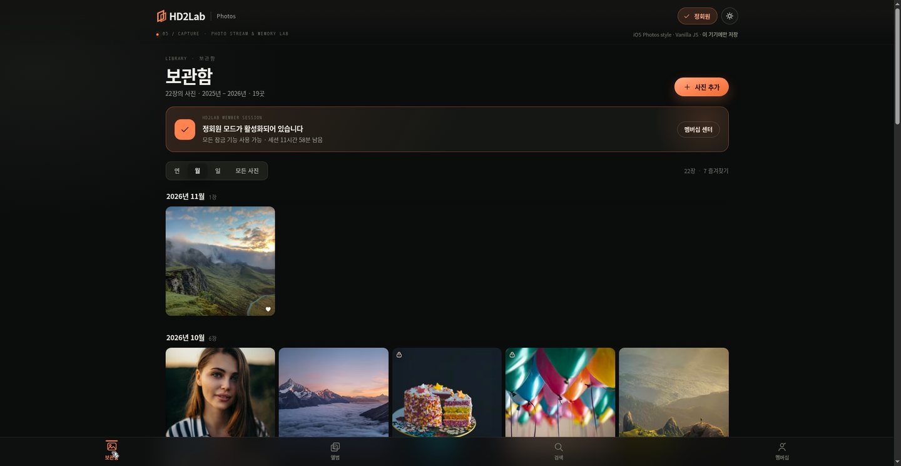
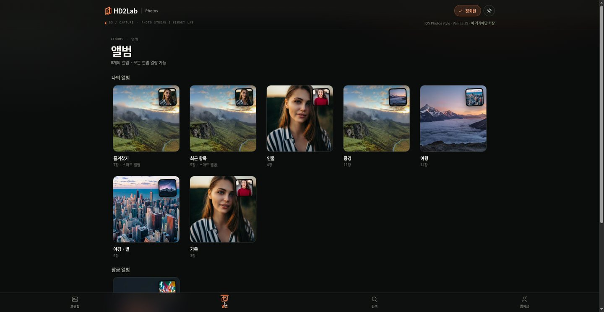
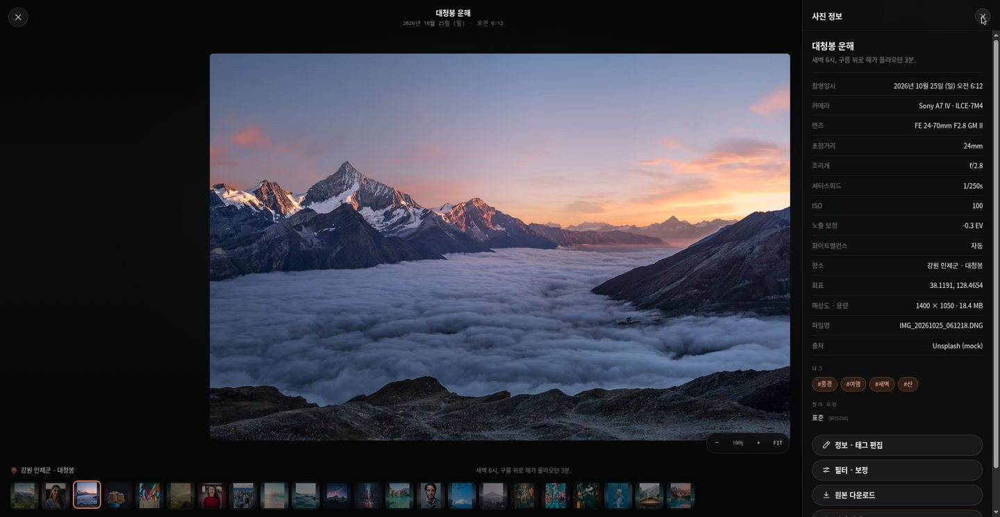
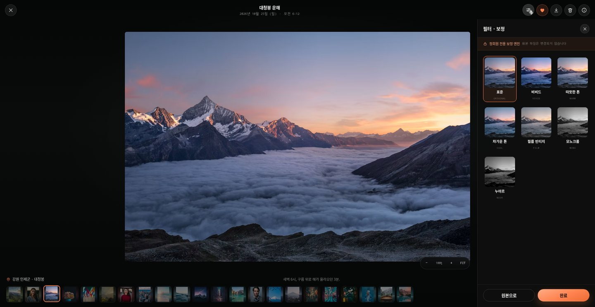
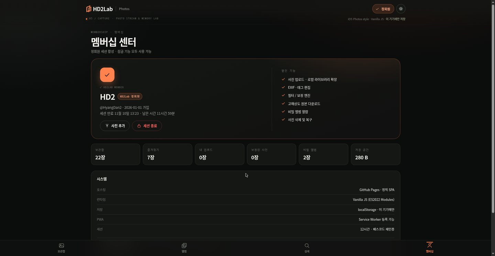
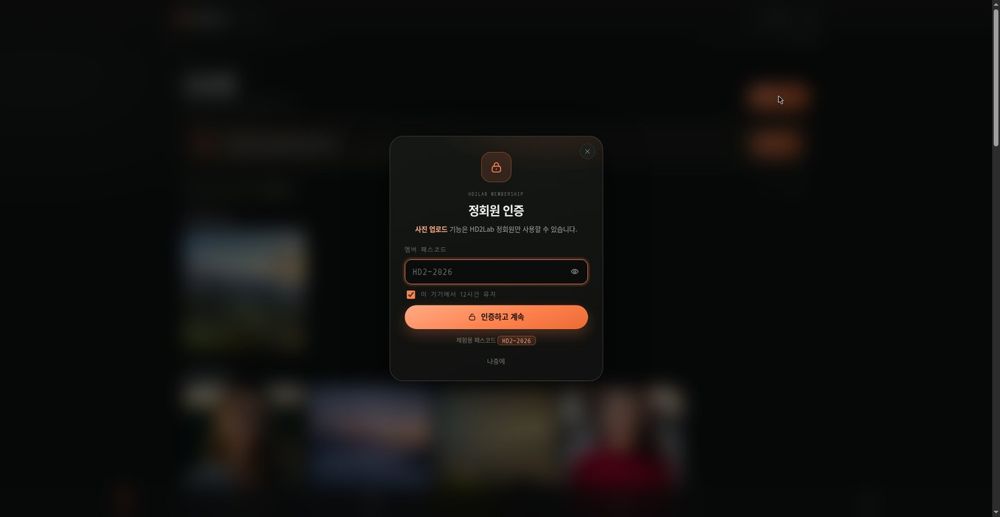
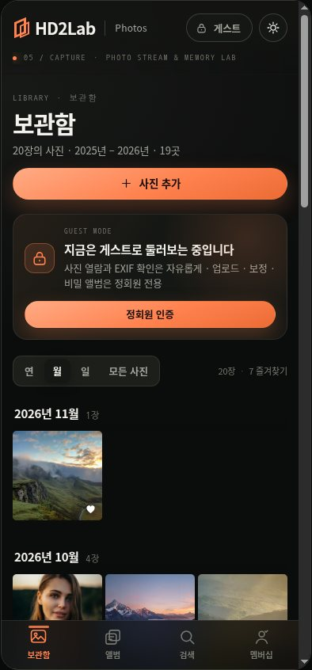
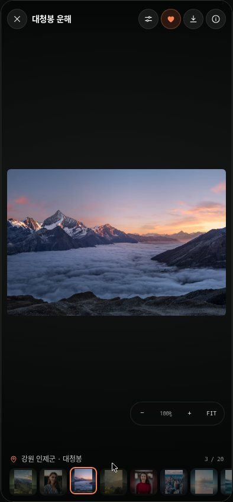
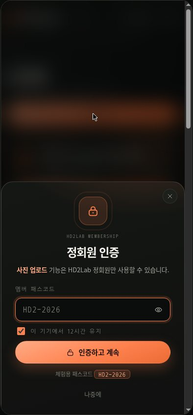

# 📸 HD2Lab | Photos (PKPilot0001)

[HD2Lab Hub](https://hd2lab.duckdns.org)의 브랜드 아이덴티티를 계승한 **iOS 사진 앱 스타일의 프로덕션 등급 정적 웹 애플리케이션**입니다. 프레임워크·빌드 도구 없이 Vanilla JavaScript(ES2022 Modules)만으로 동작하며, GitHub Pages에 그대로 배포됩니다.

- **🌐 Live**: [https://hyangdan2.github.io/PKPilot0001/](https://hyangdan2.github.io/PKPilot0001/)
- **🏛️ HD2Lab Hub**: [https://hd2lab.duckdns.org](https://hd2lab.duckdns.org)
- **🧩 Hub 카드**: [hyangdan2.github.io](https://hyangdan2.github.io/) 하단 `From the lab` 섹션

## 🖼️ 스크린샷

| 보관함 | 앨범 | EXIF · 정보 패널 |
| :---: | :---: | :---: |
|  |  |  |

| 필터 · 보정 | 멤버십 (정회원) | 정회원 인증 |
| :---: | :---: | :---: |
|  |  |  |

| 모바일 보관함 (390px) | 모바일 뷰어 | 모바일 인증 시트 |
| :---: | :---: | :---: |
|  |  |  |

> **체험용 정회원 패스코드: `HD2-2026`**
> (데모 앱이므로 패스코드는 클라이언트 번들에 포함되어 있습니다. 아래 “보안 범위” 참고)

---

## ✨ 핵심 기능

### 1. 보관함 (Library)
- **iOS 사진 앱 레이아웃**: 하단 글래스모피즘 탭 바, 라지 타이틀, 스크롤 시 헤더 축소.
- **연 / 월 / 일 / 모든 사진** 세그먼트 전환과 날짜 그룹 헤더(스티키).
- **반응형 정사각 그리드** — 320px 모바일부터 1440px 데스크톱까지 열 수가 자연스럽게 조정됩니다.
- 즐겨찾기 하트·비밀 앨범 자물쇠 배지, 지연 로딩, 호버 시 미세한 스케일 모션.
- **게스트 / 정회원 배너**로 현재 권한 상태를 항상 확인할 수 있습니다.

### 2. 앨범 (Albums)
- 즐겨찾기 · 최근 항목(스마트), 인물 · 풍경 · 여행 · 야경 · 가족(카테고리), **비밀 앨범**(정회원 전용).
- iOS 앨범 스택 커버(대표 사진 + 겹친 썸네일), 앨범별 장수 표시.
- 잠긴 앨범은 자물쇠 카드로 표시되고, 인증 전에는 사진이 DOM에조차 나타나지 않습니다.

### 3. 검색 (Search)
- **장소 · 태그 · 카메라 · 날짜** 실시간 통합 검색. 예: `부산 바다`, `2026년 4월`, `Sony`.
- 검색 범위 칩(전체/장소/태그/카메라/날짜), 추천 검색어 자동 생성.
- 결과 없음 상태, 검색어 지우기, `/` 단축키로 검색 화면 이동.

### 4. 라이트박스 (Viewer)
- 풀스크린 iOS 감성 뷰어: 이전/다음, **필름스트립**, 키보드 내비게이션(`←` `→` `Esc`).
- **확대/이동**: 버튼, 더블 탭(더블클릭), 마우스 휠, 1~4배 팬, `+`/`-`/`0`.
- **스와이프**로 사진 넘기기(모바일), 전환 애니메이션.
- **정보 패널(i)**: 카메라·모델·렌즈·초점거리·조리개·셔터·ISO·노출보정·화이트밸런스·촬영일시·장소·좌표·해상도·용량·파일명·출처, 태그, 현재 보정 톤.
- 즐겨찾기 토글, 원본 다운로드, 삭제(실행 취소 지원).

### 5. 정회원 인증 (Member)
- HD2Lab **멤버 패스코드**(`HD2-2026`) 인증 모달. iOS 스타일 시트, 입력 흔들림·오류 메시지, 5회 실패 시 60초 잠금.
- 인증 성공 시 세션을 `localStorage`에 저장(12시간), 헤더에 **✓ 정회원** 배지 활성화.
- 잠금 해제되는 기능:
  - **사진 업로드** — 파일 선택 또는 드래그 앤 드롭. FileReader + Canvas로 1600px/640px 썸네일 생성, EXIF 기본값 부여, 최대 12장·용량 초과 시 롤백.
  - **필터 · 보정** — 표준/비비드/따뜻한 톤/차가운 톤/필름 빈티지/모노크롬/누아르 7종을 실시간 CSS 필터로 적용·저장.
  - **메타데이터 · 태그 편집** — 라이트박스 정보 패널의 `정보 · 태그 편집`에서 제목·설명·장소·태그·소속 앨범을 수정하고 즉시 저장(검색·앨범에 반영).
  - **고해상도 원본 다운로드**, **사진 삭제 및 실행 취소**, **비밀 앨범 열람**.
- 멤버십 센터: 세션 만료 시각·남은 시간, 통계(보관함/즐겨찾기/업로드/보정/비밀), 시스템 정보, 세션 종료, **데모 데이터 초기화**(즐겨찾기·보정·편집·업로드를 모두 지우고 목업 상태로 복귀).

### 6. 데이터 · 오프라인
- **22장의 목업 사진** (창원 가음정·용지호수, 마산 양덕·무학산, 부산 해운대·광안리·마린시티, 서울 성수·을지로, 도쿄 신주쿠·가와구치코·우에노, 밴프, 설악산, 지리산 등).
- 각 사진마다 **실감나는 EXIF**(Sony A7 IV, iPhone 16 Pro, Fujifilm X100VI, Canon R5 …)와 좌표·태그·앨범.
- **100% 오프라인 렌더링 보장**: 원격 이미지가 실패하면 사진의 팔레트와 장면(scene)으로 생성한 **SVG 그라디언트 아트워크**로 즉시 대체됩니다. (결정론적 생성, 22장 모두 고유)
- **PWA**: `manifest.json` + `sw.js`(앱 셸 stale-while-revalidate, 이미지 cache-first)로 오프라인 실행·홈 화면 설치.
- **다크 / 라이트 모드**(시스템 설정 존중, `T` 키 전환), `prefers-reduced-motion` 대응.
- **localStorage 영속화**: 즐겨찾기·필터·삭제·업로드가 새로고침 후에도 유지되며, 손상된 스키마·버전 불일치는 안전하게 무시합니다. 저장 실패 시 트랜잭션 롤백.

---

## 🛠️ 기술 스택

- **Runtime**: Vanilla JavaScript (ES2022 Modules), 시맨틱 HTML5, Modern CSS(Custom Properties, `color-mix`, `dvh`, `aspect-ratio`)
- **Zero Frameworks**: React/Vue/번들러 없음. 정적 서버에 올리면 즉시 동작
- **Testing**: Node.js 내장 테스트 러너(`node:test`, `node:assert`)
- **Hosting**: GitHub Pages (하위 경로 `/PKPilot0001/`에서도 안전한 상대 경로 사용)

### 파일 구조

```
PKPilot0001/
├── index.html              # 앱 셸 · 아이콘 스프라이트 · 탭 바
├── style.css               # HD2Lab × iOS 디자인 시스템 (다크/라이트)
├── app.js                  # 라우팅 · 뷰 렌더 · 인증 모달 · 업로드 · 토스트
├── js/
│   ├── mockData.js         # 목업 22장 · EXIF · 앨범 · SVG 아트워크 엔진
│   ├── store.js            # 상태 · 영속화 · 즐겨찾기/필터/삭제 · 검색/그룹핑
│   ├── auth.js             # 패스코드 검증 · 세션 · 시도 제한
│   └── viewer.js           # 라이트박스 · EXIF 패널 · 필터 · 확대/스와이프
├── tests/unit/app.test.js  # 단위 테스트 39개
├── tests/preview/viewport.html  # 390×844 모바일 뷰포트 확인용 프리뷰
├── manifest.json           # PWA 매니페스트
├── sw.js                   # 서비스 워커 (오프라인 셸)
├── favicon.svg             # HD2Lab 듀얼 스큐 마크 (벡터 원본)
├── favicon.ico             # 멀티사이즈 16 · 32 · 48
├── favicon-32x32.png       # 브라우저 탭 아이콘
├── apple-touch-icon.png    # iOS 홈화면 180×180
├── icon-192.png            # PWA 192×192
├── icon-512.png            # PWA 512×512
├── og-image.png            # 카카오톡 · 소셜 공유 썸네일 1200×630
├── social-preview.png      # og-image 동일본 (소셜 미리보기)
├── assets/                 # (레거시) 이전 아이콘 세트
├── tools/generate_brand_assets.py  # 브랜드 에셋 재생성 스크립트
├── docs/screenshots/       # README · PR용 스크린샷 (데스크톱 / 모바일)
└── README.md
```

---

## 🧪 테스트

외부 의존성 없이 Node.js 20+ 내장 러너로 실행합니다.

```bash
cd PKPilot0001
npm run test:unit
# 또는
node --test tests/unit/*.test.js
```

검증 항목(총 **39**개):

| 영역 | 내용 |
| --- | --- |
| 목업 데이터 | 22장 고유 id, 필수 EXIF 필드, ISO 8601 날짜, 좌표 범위, 생활권 장소, 앨범 참조 무결성, SVG 폴백 결정론 |
| 날짜 · 그룹핑 | 한국어 날짜/시간(오전·오후·정오), `toLocalIso`, 바이트 표기, 연/월/일/전체 그룹 합계, 최신순 유지 |
| 검색 | 장소·태그·카메라·날짜 검색, 범위(scope) 필터, 빈 검색어, 결과 없음 |
| 스토어 | 최신순 정렬, 게스트 비밀 사진 차단, 즐겨찾기 영속화, 필터 영속화·거부, 메타데이터 편집·검증·영속화, 삭제/복구, 업로드 한도, 저장 실패 롤백, 손상 스키마 복구, 데모 초기화, 앨범·통계 집계, 최근 30일 |
| 인증 | 패스코드 정규화, 세션 생성·복원·만료, 5회 실패 잠금 및 해제, 로그아웃, 만료 세션 정리, 저장소 부재 대응 |

---

## 🚀 로컬 실행

```bash
cd PKPilot0001
python3 -m http.server 8080
# 브라우저에서 http://localhost:8080
```

또는 저장소 루트에서 `python3 -m http.server 8080` 후 `http://localhost:8080/PKPilot0001/`.
(ES Modules를 사용하므로 `file://`로 직접 열면 동작하지 않습니다.)

모바일(390 × 844) 레이아웃은 `tests/preview/viewport.html`을 같은 서버에서 열어 iframe 뷰포트로 확인할 수 있습니다.

### GitHub Pages

`main` 브랜치의 `/PKPilot0001/` 경로가 그대로 배포됩니다. 빌드 단계가 없으며, 모든 경로는 상대 경로(`./js/...`)라 저장소 하위 경로 배포에서도 안전합니다.

---

## 🔐 보안 범위 (중요)

이 앱은 **서버가 없는 정적 데모**입니다. “정회원 인증”은 이 브라우저에서 잠금 UI를 해제하는 **클라이언트 측 게이트**이며, 다음을 보장하지 않습니다.

- 패스코드는 번들에 포함된 공개 값(`HD2-2026`)입니다. 소스를 읽으면 누구나 알 수 있습니다.
- 업로드한 사진은 서버로 전송되지 않고 **이 브라우저의 `localStorage`에만** 저장됩니다. 기기·브라우저를 바꾸면 사라지며, 다른 사람이 같은 브라우저 프로필을 쓰면 볼 수 있습니다.
- 실제 접근 제어가 필요하면 서버 측 인증(세션 토큰, 권한 검사)과 암호화된 저장소가 필요합니다.

디자인 원칙: **민감한 정보를 서버로 보내지 않는다**, **인증 실패 시 아무 것도 노출하지 않는다**, **삭제는 실행 취소 가능한 소프트 삭제**.

---

## 🎨 브랜딩

| 항목 | 값 |
| --- | --- |
| 타이틀 | `HD2Lab | Photos` · 서브 `PKPilot0001` |
| 서브카피 | `iOS Photos style production-grade static web application` |
| 아이브로우 | `05 / CAPTURE · PHOTO STREAM & MEMORY LAB` |
| 액센트 | HD2Lab Orange `#ff824f` (라이트 `#e5622d`) |
| 베이스 | HD2Lab Ink `#101110` / Light `#f2f2f7` |
| 타이포 | SF Pro 계열 시스템 폰트 + 모노스페이스 메타 |
| 모션 | iOS 스프링 느낌의 `cubic-bezier(.16,1,.3,1)`, 글래스 블러, 카드 부상 |
| 푸터 | `+ STAY CURIOUS + KEEP BUILDING + LIVE BETTER` |

---

## 🗺️ 로드맵 (다음 단계 후보)

- IndexedDB 기반 대용량 업로드 저장 + 썸네일 Blob 캐시
- 얼굴/장면 인식 기반 자동 앨범(온디바이스)
- EXIF 실제 파싱(`exifr` 없이 ArrayBuffer 파서) 및 위치 지도 뷰
- 공유 링크(암호화된 프래그먼트)와 멤버별 앨범 권한
- 서버 인증 연동(HD2Lab Server HQ 세션)

---

## 📄 라이선스

© 2026 HD2Lab · PKPilot0001. 개인 프로젝트입니다. 목업 사진은 [Unsplash](https://unsplash.com/license) 이미지를 사용하며, 오프라인 폴백 아트워크는 이 저장소에서 생성한 SVG입니다.
