# HD2Lab | Midpoint (PKPilot0002)

여럿이 만날 때, 딱 가운데.
전국 어디든 출발지만 찍으면 **N명 모두에게 가장 공평한 만남 지점**과 **만날 거점**을 찾아 주는 정적 웹앱입니다.
대중교통으로 모이면 전국 전철역·KTX/SRT·터미널에서, 자차로 모이면 고속도로 IC·휴게소·대형 주차 거점에서 골라 줍니다.
거점이 정해지면 **앱을 떠나지 않고** 그 주변 맛집·카페를 실시간으로 찾아 1차+2차 약속 코스까지 만들어 줍니다.

- 라이브: <https://hyangdan2.github.io/PKPilot0002/>
- 외부 API 키 없음 · 빌드 없음 · 정적 파일만 (Leaflet 1.9.4 로컬 번들)

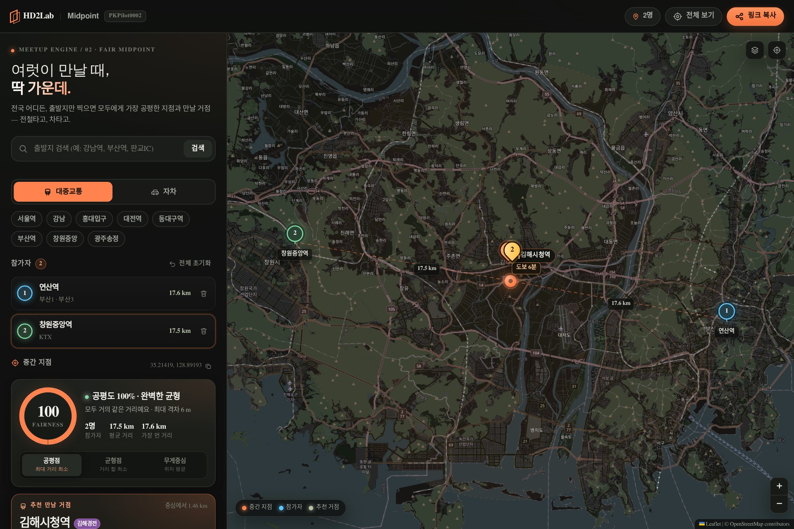

| 약속 코스 — 강남역 | 맛집·카페 목록 |
| --- | --- |
| 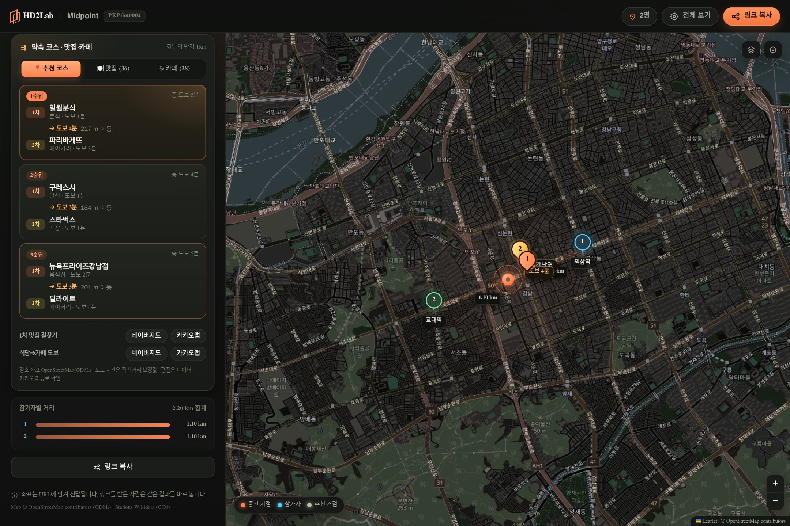 | 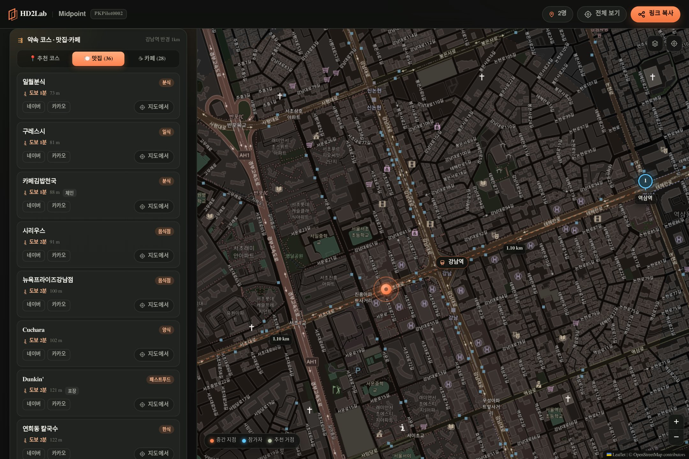 |
| **부산 서면 코스** | **모바일 코스** |
| 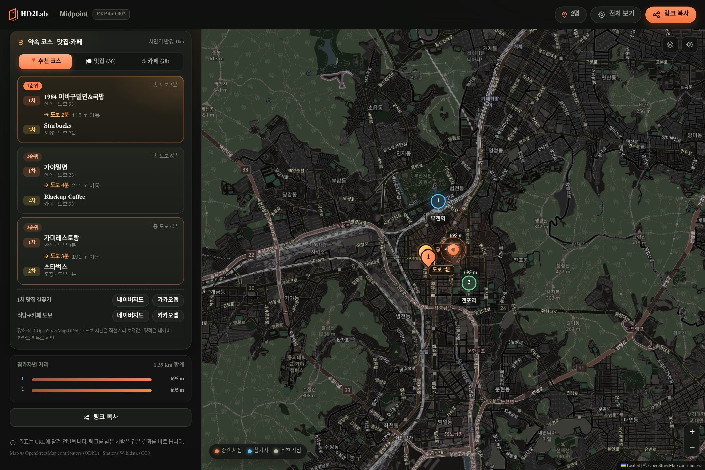 | 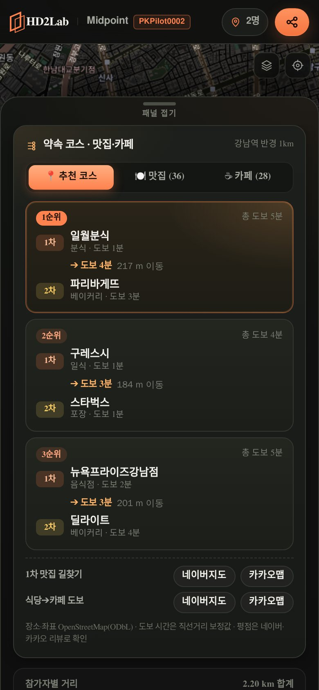 |

| 전국 실시간 인앱 탐색 (이수역) | 실시간 조회 중 반경 넓히기 |
| --- | --- |
| 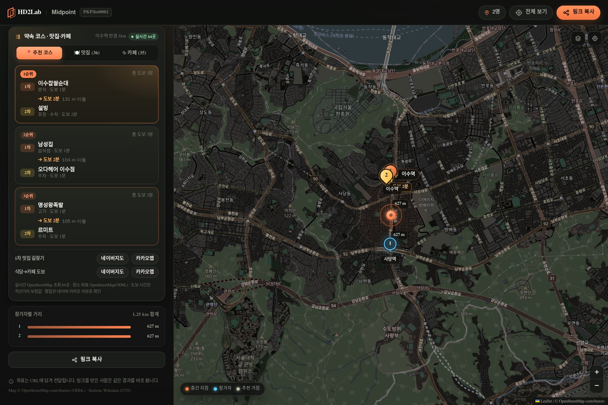 | 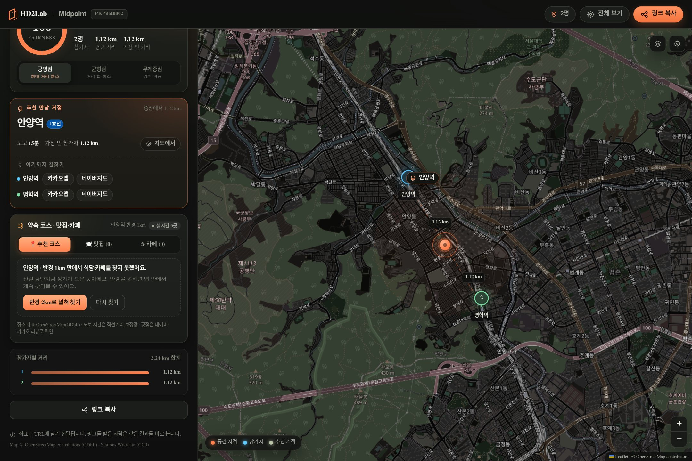 |

| 모바일 실시간 탐색 | 자차 모드 실시간 탐색 |
| --- | --- |
| 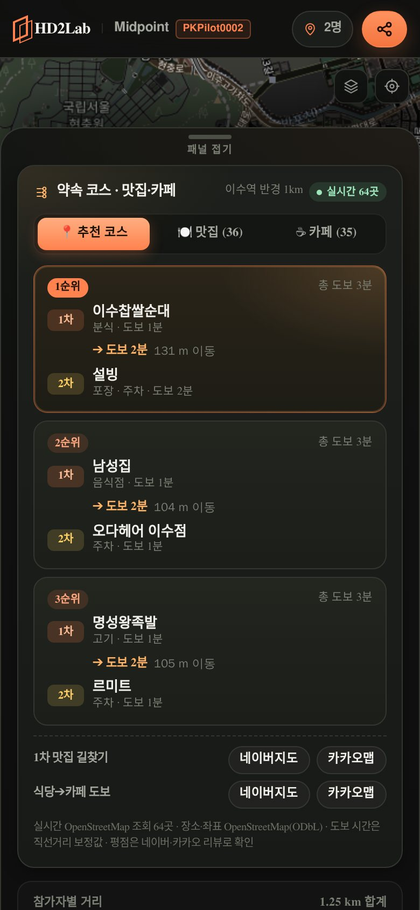 | 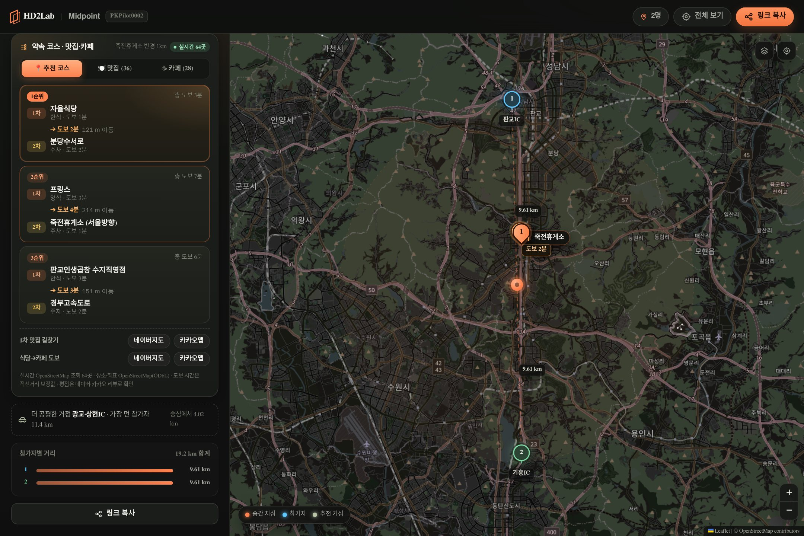 |

| 영남권 자차 모드 | 장거리(서울↔부산) KTX 환승역 |
| --- | --- |
| 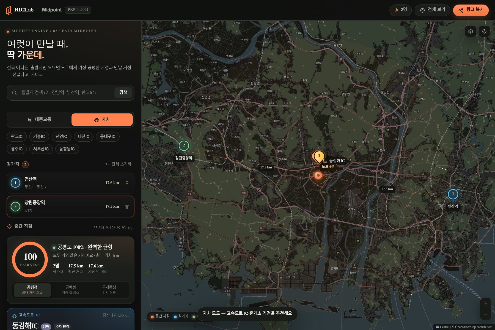 | 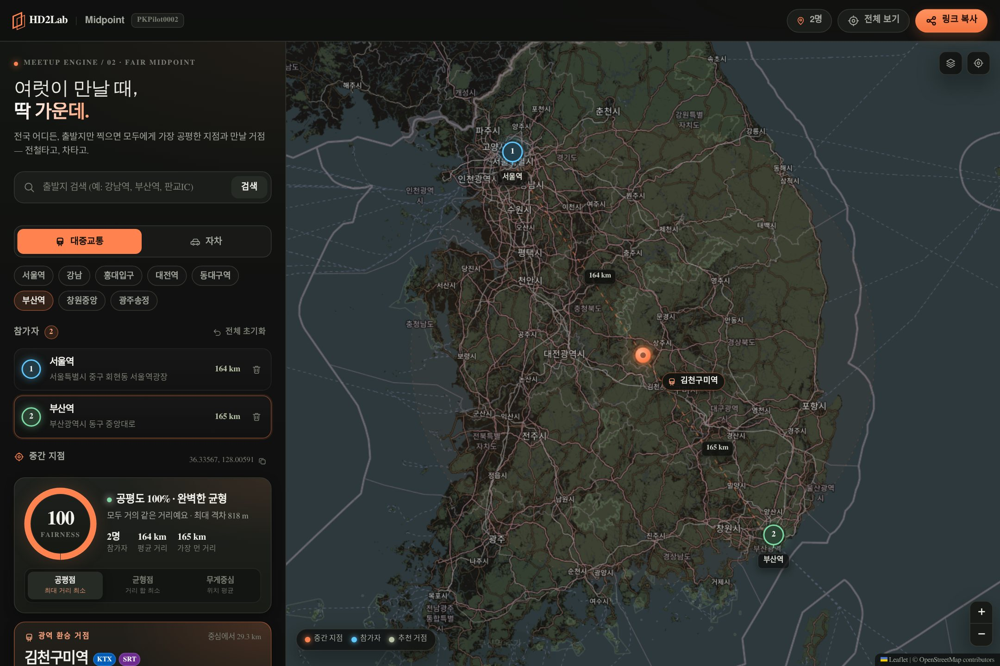 |

## 기능

**출발지 입력**
- 지도 클릭으로 참가자 추가 (Person 1, Person 2 … 고유 색 마커)
- **검색창 실시간 자동완성**: 입력하는 즉시 내장 957개 역·터미널 + 799개 IC·휴게소·주차 거점을 골라 제안 (이름 부분 일치·초성 `ㄱㄴ` 검색, 최대 7개)
  - 항목을 누르면 바로 출발지로 추가, ↑↓ + Enter로도 선택
  - 내장 데이터에 없으면 Enter·검색 버튼으로 Nominatim 외부 주소 검색
- 빠른 선택 — 모드에 맞춰 바뀐다: 대중교통(서울역·강남·홍대입구·대전역·동대구역·부산역·창원중앙·광주송정) / 자차(판교IC·기흥IC·천안IC·대전IC·동대구IC·경주IC·서부산IC·동창원IC)
- 마커 드래그로 미세 조정, 이름 인라인 수정, 개별 삭제, 전체 초기화
- 최대 12명. 2명 이상이면 즉시 계산

**중간 지점 엔진 — 세 가지 관점**
| 모드 | 계산 | 의미 |
| --- | --- | --- |
| **공평점** (기본) | 최소 외접원의 중심 (1-center) | 가장 먼 사람의 거리를 최소로 → 모두에게 고르게 |
| 균형점 | 기하 중앙값 (Weiszfeld) | 모든 사람의 이동 거리 **합**을 최소로 |
| 무게중심 | 구면 무게중심 (3D 벡터 평균) | 위치의 평균 — 좌표 중심 |

- 지도에 오렌지 펄스 마커로 표시, 참가자별 **점선 연결선 + 직선 거리(km)**
- 평균 거리만큼의 옅은 원(공평 반경) 표시
- **공평도 지수**: `100 × (1 − (최대거리 − 최소거리) / (최대거리 + 최소거리))`
  — 모두 같은 거리면 100%, 한 사람만 멀수록 0%에 가까워집니다. 값에 따라 "완벽한 균형 / 아주 공평해요 / 무난한 균형 / 조금 치우쳤어요 / 한쪽에 쏠렸어요" 등급 표시.
- 참가자별 거리 막대와 합계

**추천 만남 거점 — 이동 수단 토글**
- **🚇 대중교통 모드**: 전국 도시철도(수도권 604개 + 부산·대구·대전·광주 전철) + KTX/SRT 정차역 50곳 + 고속·시외버스터미널 26곳에서 추천. 노선 배지와 함께 표시
- **🚗 자차 모드**: 전국 고속도로 IC 586곳 + 휴게소·만남의광장 205곳 + 대형 주차 복합몰 8곳에서 추천. 고속도로 배지 + "주차 편리" 배지 표시
- 참가자 사이 최대 거리가 **50km 이상인 장거리 모임**에서는 환승 거점 가중치가 붙는다 —
  대중교통은 KTX/SRT 정차역·복합환승센터를, 자차는 휴게소·IC를 우선 추천해 서울↔부산 같은 모임이
  "중간의 어느 역"이 아니라 "어디서든 닿기 쉬운 광역 거점"으로 스냅된다
- 더 공평한 후보를 함께 제안 (가장 먼 참가자의 거리가 더 짧은 곳)

**실제 길찾기 · 내비게이션 연동**
- 추천 거점 카드에 참가자별 길찾기 버튼: 카카오맵 · 네이버지도 (자차 모드는 티맵까지)
  - 대중교통 모드: 카카오맵 길찾기 · 네이버지도 대중교통 경로
  - 자차 모드: 카카오내비 · 네이버지도 자동차 경로 · 티맵 내비 앱 스킴
- 원클릭으로 각자 전철로 몇 분, 차로 몇 분 걸리는지 바로 확인

**🍽️ 주변 맛집·카페 · 1차+2차 약속 코스 — 전국 어디서든 앱 안에서**
- **30개 주요 거점은 내장 스냅샷으로 0ms 즉시** 표시 (강남·홍대·신촌·종로·서울역·용산·왕십리·성수·잠실·영등포·사당·고속터미널·신림·혜화·광화문·노원·판교·수원,
  부산 서면·해운대·부산역, 대구 동성로·동대구, 대전 둔산·대전역, 광주 상무지구·광주송정, 창원 상남동·창원중앙, 김해시청)
- 그 밖의 **전국 900여 개 역·터미널·IC·휴게소·임의의 중간 지점**은 **앱 안에서 실시간 조회** —
  브라우저가 OpenStreetMap Overpass API(미러 4곳)를 직접 호출해 반경 1km 의 이름 있는 식당·카페·베이커리를 받아 오고,
  Overpass 대기열이 밀리면 OSM 지도 API(bbox)로 자동 후퇴합니다. 같은 세션·같은 좌표는 메모리 캐시라 재조회가 없습니다
  - 조회 중에는 `🔄 주변 맛집·카페 찾는 중…` 스켈레톤이 떠 화면이 멈추지 않습니다 (일반 2~6초)
  - 반경 1km 에 아무것도 없으면 **반경 2km·3km 로 넓혀 찾기**, 조회 실패 시 **다시 찾기** — 모두 앱 안에서 해결
- 결과 카드 하단에 **[📍 추천 코스 | 🍽️ 맛집 (N) | ☕ 카페 (N)]** 서브탭
- **추천 코스 카드** — `1차: {맛집} ({분류}, 도보 N분)` ➔ `도보 M분 (D m 이동)` ➔ `2차: {카페} ({특징}, 도보 N분)`
  - 1차는 거점에서 가까운 식당, 2차는 그 식당에서 **도보 2~5분(100~350m)** 카페. 야외석·디저트·베이커리 카페에 가산점, 체인은 감점
  - 식당·카페가 겹치지 않는 코스 3개 제안 (이상 구간이 모자라면 80~600m까지 넓혀서)
  - **1차 맛집 길찾기 · 식당➔카페 도보 길찾기** 원클릭 (네이버지도 `/walk` · 카카오맵 `by=FOOT`)
- **맛집·카페 목록** — 카테고리 배지(한식·일식·중식·양식·고기·치킨·분식·해산물·아시아·베이커리·디저트·카페), 도보 분·거리,
  특징 태그(야외석·포장·주차·무장애·체인), 네이버·카카오 리뷰 링크, **지도에서** 버튼
- **지도 시각화** — 코스 선택 시 `① 식당`(오렌지 핀) `② 카페`(앰버 핀)와 거점➔식당➔카페 **점선 폴리라인**, 구간에 도보 분 라벨,
  핀 클릭 시 이름·분류·리뷰 링크 팝업
- 자차 모드에서는 '주차' 태그가 있는 장소를 앞세워 정렬
- "네이버·카카오 지도에서 찾아보세요" 로 앱 밖으로 내보내던 안내와 외부 탐색 링크는 **전부 삭제** — 발견은 앱 안에서 끝납니다

**공유 · 반응형**
- 상태를 URL에 인코딩: `?p=37.5665,126.978|37.4979,127.0276&n=재혁~민지&m=centroid&t=car`
  (좌표 5자리 ≈ 1m 정밀도, `n`은 이름을 바꿨을 때만, `m`은 기본값 `fair`가 아닐 때만, `t`는 자차 모드일 때만)
- 링크를 받은 사람은 같은 결과·같은 모드를 바로 봅니다. 상태가 바뀔 때마다 `history.replaceState`로 주소 갱신
- 데스크톱(1440px) 좌측 패널 / 모바일(390px) 하단 슬라이드 시트(끌어서 펼침·접힘)
- 모바일 사파리 대응: 입력창 16px 고정(포커스 시 강제 확대 방지), 페이지 확대·축소 차단
  (`user-scalable=no` + `gesturestart`/더블탭 차단), 지도 핀치 줌은 Leaflet 그대로 유지

## 파일 구조

```
PKPilot0002/
├── index.html            화면 마크업 + 아이콘 스프라이트
├── style.css             HD2Lab 다크 테마 · 지도/패널/시트 레이아웃
├── app.js                Leaflet 지도 · 참가자 · 모드 토글 · 결과 UI
├── js/
│   ├── core.js           순수 계산 (거리·중간 지점·공평도·URL·거점 추천·주변 장소·약속 코스) — DOM 의존 없음
│   ├── stations.js       전국 도시철도·KTX/SRT·터미널 스냅샷 957곳 (자동 생성)
│   ├── driving_spots.js  전국 고속도로 IC·휴게소·주차 거점 스냅샷 799곳 (자동 생성)
│   ├── places.js         모임 거점 30곳 주변 맛집·카페 1,435곳 (자동 생성 · OSM ODbL)
│   ├── live_places.js    전국 임의 좌표 실시간 맛집·카페 조회 (Overpass 미러 → OSM 지도 API fallback · 세션 캐시)
│   ├── directions.js     카카오맵·네이버지도·티맵 길찾기·도보 딥링크 · 지도 검색 링크
│   └── landmarks.js      만남 거점 랜드마크 9곳 (Nominatim 확인)
├── vendor/leaflet/       Leaflet 1.9.4 (CDN 장애 없이 동작하도록 로컬 번들)
├── tools/
│   ├── build_network.py      stations.js·driving_spots.js 생성기 (Wikidata + OSM Overpass)
│   ├── build_places.py       places.js 생성기 (OSM Overpass — 이름·좌표·영업 태그·주차장)
│   ├── build_stations.py     (구버전 수도권 전용 생성기 — build_network.py로 대체)
│   └── data/                 거점 정의(hubs.json)·장소 스냅샷(places.json)·KTX/터미널 좌표
├── tests/
│   ├── run_tests.py      단위 테스트 러너 (Playwright + http.server)
│   ├── unit/             테스트 하네스·케이스 141개 (core + places + live_places)
│   └── visual/capture.py 화면 검증 + 스크린샷 (기본·모드 토글·영남권·장거리·약속 코스·실시간 인앱 탐색·fallback)
└── docs/screenshots/     데스크톱·모바일 스크린샷
```

## 데이터 출처와 갱신

- 도시철도역 좌표·노선: Wikidata (CC0)
- 고속도로 IC·휴게소·본선 도로명: OpenStreetMap (ODbL)
- 맛집·카페 POI: OpenStreetMap Overpass API (ODbL) — 이름 있는 `restaurant`·`cafe`·`fast_food`·`bakery`·`ice_cream`,
  `shop=bakery|coffee|dessert`, 반경 800m, 주차장(`amenity=parking`) 150m 이내 여부로 '주차' 태그
- 실시간 맛집·카페 조회: 브라우저가 OpenStreetMap Overpass API 미러(`overpass-api.de` → `lz4` → `kumi` → `private.coffee`)를
  시간차로 동시 호출하고, 모두 밀리면 `api.openstreetmap.org/api/0.6/map.json`(bbox)으로 후퇴합니다. 반경 1km,
  이름 있는 식당·카페·베이커리만, 세션 메모리 캐시(`Map`)로 재요청을 막습니다. 스냅샷과 같은 분류·정제 규칙을 씁니다
- KTX/SRT 정차역·버스터미널·대형 주차 거점: `tools/data/*.json` (직접 확인)

```sh
python3 tools/build_network.py            # 캐시 재사용
python3 tools/build_network.py --refresh  # 원본부터 다시 받기
python3 tools/build_places.py             # 맛집·카페 수집 (캐시 재사용)
python3 tools/build_places.py --all       # 남은 거점을 한 번의 Overpass 요청으로 수집
python3 tools/build_places.py --emit-only # 캐시만으로 js/places.js 재생성
```

> OSM에는 평점이 없습니다. 그래서 '맛집' 순위는 **거점에서 가까운 순**(도보 분)이고,
> 평점·리뷰는 각 장소의 네이버·카카오 지도 링크에서 확인하도록 넘깁니다.
> OSM 등재 장소가 적은 지방 거점은 실시간 조회가 자동으로 채우고, 그래도 비면 반경을 넓혀 다시 찾습니다.

## 로컬에서 실행

```sh
cd PKPilot0002
python3 -m http.server 8080
# http://localhost:8080/
```

ES 모듈을 쓰므로 `file://`로 열면 동작하지 않습니다. 정적 서버가 필요합니다.

## 테스트

```sh
python3 tests/run_tests.py            # 단위 테스트 141개
python3 tests/visual/capture.py --check   # Chromium 화면 검증
python3 tests/visual/capture.py       # 검증 + 스크린샷 갱신
```

- 단위 테스트: Haversine, 구면 무게중심, Weiszfeld·최소 외접원, 공평도, 좌표 정규화, URL 인코딩/파싱(잘못된 좌표·인원 초과·해시·전체 URL), 역·랜드마크 추천, 검색 자동완성(완전 일치·부분 일치·초성·랜드마크), 표시 형식,
  **거점↔허브 매칭, 반경 필터·종류 필터·주차 우선, 코스 페어링(도보 100~350m·중복 없음·합계), 검색·도보 딥링크, POI 데이터 정합성(반경 800m·좌표·링크)**,
  **실시간 POI 파싱(업종 분류·이름 정제·거리·도보·주차·중복 제거·상한), Overpass 쿼리·bbox, 내장+실시간 병합, 실시간 POI 만으로 코스 생성, 미러 fallback·타임아웃·세션 캐시**
- 화면 검증: 타일 로드, 핀/마커 수, 결과 카드, URL 상태, 공유 링크 왕복, 모드 전환, 삭제/초기화, 모바일 시트 접힘·펼침,
  **강남·홍대·서면·김해 코스 카드·탭 전환·지도 ①·② 마커·폴리라인,
  비허브 거점(이수·의정부·천안·구미) 실시간 인앱 탐색과 외부 링크 미노출, 0곳·실패 모의 응답에서 스켈레톤 → 반경 2km 넓히기 → 다시 찾기, 모바일 가로 넘침**
- Node.js 없이 Playwright(Chromium)만 사용합니다. `pip install playwright && playwright install chromium` 필요.

## 데이터 · 타일

| 대상 | 출처 | 비고 |
| --- | --- | --- |
| 지도 타일 | OpenStreetMap 표준 타일 | 다크 테마는 CSS 필터(`invert + hue-rotate`)로 톤만 바꿉니다. 외부 키 불필요 |
| 지오코딩 | Nominatim (search / reverse) | 공개 인스턴스 정책에 맞춰 요청을 1초 간격으로 큐잉, 결과 캐시 |
| 지하철역 좌표 | Wikidata (CC0) | `tools/build_stations.py`로 수도권 589개 역 생성 |
| 맛집·카페 POI | OpenStreetMap Overpass (ODbL) | `tools/build_places.py` — 30개 거점 반경 800m, 1,435곳 + 브라우저 실시간 조회. 평점 없음 → 네이버·카카오 리뷰 링크 |
| 랜드마크 | OpenStreetMap Nominatim | `js/landmarks.js` — 추천 후보에 함께 사용 |

> 지도 타일은 초기 기획의 CartoDB Dark Matter를 쓰지 않습니다. 2026년 11월 확인 결과 `basemaps.cartocdn.com`의 dark_all 타일이 **API 키 없이는 "API KEY REQUIRED" 워터마크 타일**을 돌려주기 때문입니다(키 없는 대안 중 OSM 타일을 선택). 필요하면 `app.js`의 `TILES` 상수만 교체하면 됩니다.

## 제약

- 네트워크가 있어야 지도·주소가 보입니다. 오프라인 캐시는 없습니다.
- Nominatim 공개 인스턴스는 초당 1회 수준으로만 호출합니다. 대량 사용 시 자체 프록시가 필요합니다.
- 거리는 직선(대권) 거리이고 도보 시간은 4.5km/h 기준 추정치입니다. 실제 이동 시간·경로는 반영하지 않습니다.
- 역 추천은 좌표 최근접 방식이라 출입구·환승 동선은 고려하지 않습니다.
- 맛집·카페 목록은 OSM에 이름이 등재된 곳만 담습니다. 등재되지 않은 곳은 앱의 실시간 조회로도 잡히지 않으며,
  영업 여부·평점은 지도 리뷰에서 확인해야 합니다.
- 실시간 조회는 공개 Overpass API·OSM 지도 API 를 쓰므로 서버가 붐비면 몇 초 더 걸리거나 실패할 수 있습니다
  (미러 4곳 + OSM 지도 API 후퇴로, 화면의 '다시 찾기' 버튼). 한 번 받은 좌표는 세션 동안 캐시됩니다.
- 코스의 도보 거리는 두 좌표의 직선거리에 1.25배 보정을 준 값입니다. 실제 보행 경로·횡단보도는 반영하지 않습니다.

## 브라우저

최신 Chromium·Safari·Firefox. ES 모듈, `dvh` 단위, `color-mix()`를 사용합니다(iOS 16.4+ / Safari 16.4+).
