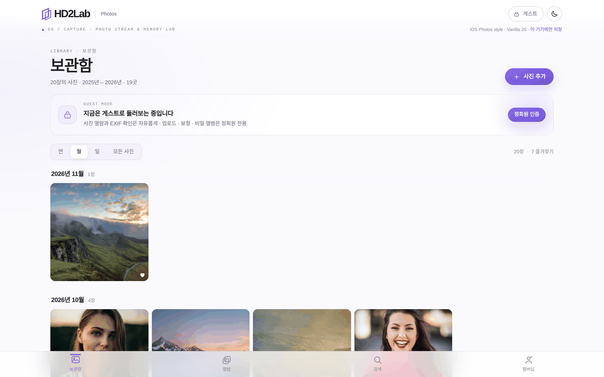
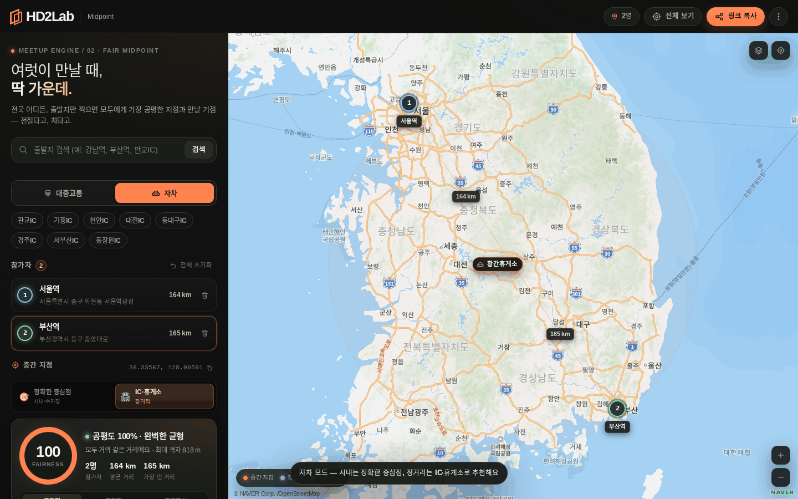
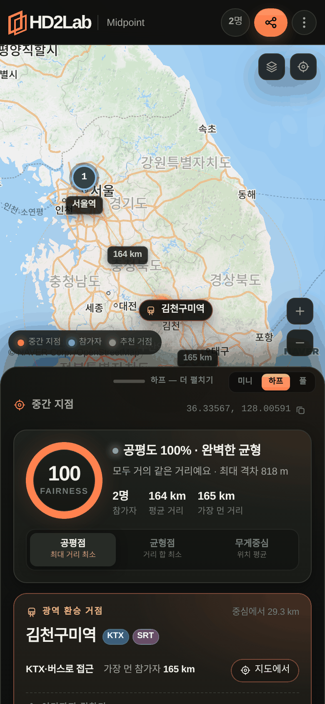

PKPilot 시리즈의 첫 두 앱은 성격이 정반대입니다. 하나는 사진을 **가만히 모아 두는** 앱이고, 다른 하나는 두 사람 사이의 **거리를 계산하는** 앱입니다. 그런데 만들다 보니 같은 질문에 부딪혔습니다. 이 앱이 정말 서버를 가져야 하는가.

## PKPilot0001 · Photos

사진 앱을 만들 때 가장 먼저 정한 것은 사진을 어디에도 올리지 않는다는 점이었습니다. 사진은 브라우저 안에서만 다뤄지고, 보관함은 `localStorage`에 Base64로 저장됩니다. 서버도, 계정도, 사진이 올라갈 곳도 없습니다. 사진을 더하는 버튼은 기기 안 보관함에 한 장을 넣을 뿐입니다. 대신 브라우저 저장소를 비우면 사진도 함께 사라집니다.

화면은 iOS 사진 앱의 결을 따랐습니다. 연·월·일 단위로 묶어 보여 주고, 사진을 누르면 원본과 EXIF를 함께 보여 줍니다. 촬영 기기와 렌즈, 조리개·셔터·ISO, 촬영 시각을 사진 옆에 그대로 붙여 두면 사진이 조금 더 사진처럼 보입니다.

게스트와 정회원을 나눈 것도 이 앱의 결정입니다. 게스트는 보관함 열람과 EXIF 확인까지 할 수 있고, 사진 추가·보정·비밀 앨범은 정회원으로 열립니다. 인증은 계정이 아니라 패스코드 한 줄입니다. 토이 프로젝트에 회원 시스템을 붙이는 순간 관리할 것이 두 배가 되기 때문입니다.

남은 숙제도 분명합니다. `localStorage`는 기기마다 따로이고 용량도 넉넉하지 않습니다. 기기를 바꾸면 사진이 따라오지 않습니다. 서버 저장소로 옮기는 안은 다음 과제로 남겨 두었습니다.

## PKPilot0002 · Midpoint

중간 지점 앱은 반대로 계산이 전부인 앱입니다. 출발지를 두 곳 이상 넣으면, 모든 사람에게 최대한 공평한 만남 지점을 찾아 줍니다. 여기서 "중간"을 어떻게 정의하느냐가 앱의 성격을 결정합니다.

- **자차**는 도로 거리를 기준으로 계산합니다. 직선거리로 중간을 잡으면 산을 넘는 길이 나옵니다.
- **대중교통**은 역과 터미널을 후보로 두고 접근 거리를 비교합니다.
- 자차 모드에는 `[🎯 정확한 중심점 | 🛣️ IC·휴게소]` 토글이 있습니다. 50km 미만의 근거리에서는 정확한 중심점이 기본이고, 장거리에서는 IC와 휴게소를 경유 후보로 올립니다.

결과 화면에는 공정도가 함께 나옵니다. 출발지들 사이의 최대 격차로 점수를 매기고, 격차가 작을수록 높은 점수를 줍니다. 스크린샷의 두 출발지는 164km와 165km, 최대 격차 818m로 공정도 100점이 나왔습니다.

모바일에서는 같은 정보를 3단 바텀시트로 나눴습니다. 미니(134px)는 지도를 최대한 보여 주고, 하프(48dvh)는 요약과 후보 한 건, 풀(80dvh)은 후보 목록 전체를 보여 줍니다. 시트는 드래그로도, 버튼으로도 단계가 바뀝니다.

## 즉시성이 기능이 되는 순간

지도 앱에서 기다림은 곧 실패입니다. 그래서 성능을 손봤습니다.

- 역지오코딩 결과는 7일, 주변 장소(POI)는 30분 캐시합니다.
- 검색에는 8초 타임아웃을 두어 멈춘 요청이 화면을 붙잡지 않게 했습니다.
- 출발지를 추가하면 지도와 요약이 바로 갱신됩니다. 측정값은 78ms, 체감으로는 0ms에 가깝습니다.

여기에 네이버·카카오 평점 배지를 붙이고 추천순·거리순 정렬을 넣었습니다. 사용자가 "어디가 중간인가"에서 멈추지 않고 "그래서 어디서 만날까"까지 갈 수 있어야 지도 앱이 완성됩니다. 단위 테스트는 146건이 통과합니다.

## 두 앱에서 남은 것

- 사진은 여전히 기기 안에만 있습니다. 기기 간 동기화는 저장소를 어디에 둘지의 문제이고, 그 결정을 미룬 채 기능을 더 붙이면 나중에 옮기기 어려워집니다.
- 지도 앱은 캐시가 곧 성능입니다. 다음에는 오프라인에서 마지막으로 본 결과를 얼마나 오래 보여 줄지 정해야 합니다.
