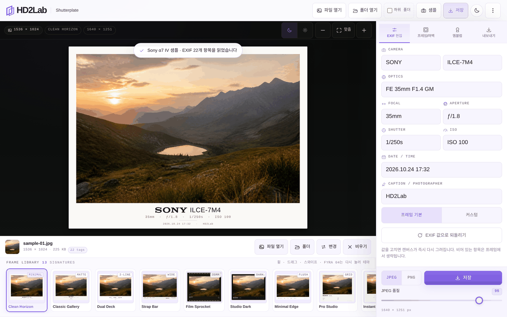
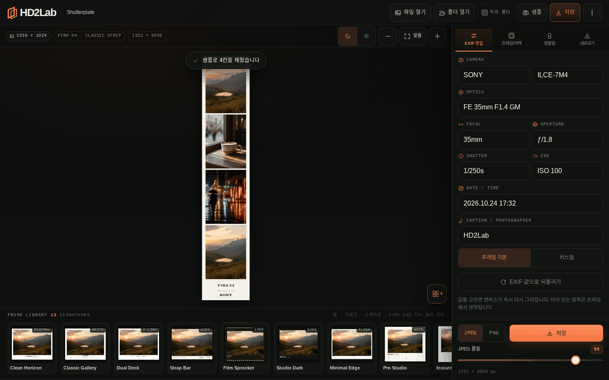

Shutterplate는 사진 한 장을 넣으면 필름 프레임을 입혀 다시 내려주는 스튜디오입니다. 정확히는 **브라우저 안에서만** 그렇습니다. 사진은 어디로도 전송되지 않고, EXIF도, 캔버스도, 저장도 모두 방문자의 기기 안에서 끝납니다.

## 원칙 세 가지

**1. 사진은 브라우저 밖으로 나가지 않습니다.** EXIF는 로컬 `exifr`로 읽고, 합성은 `<canvas>`에서 합니다. 서버가 없으니 원본이 남을 곳도 없습니다. 대신 결과물의 해상도는 원본을 따라갑니다. 4컷은 상한을 7200px(약 10MP)로 두고, 그보다 큰 사진은 4096 → 3072 → 2048px 순서로 낮춰 다시 그립니다. 브라우저마다 캔버스 상한이 달라서 한 번에 실패하지 않도록 단계를 두었습니다.

**2. EXIF 원문을 고치지 않습니다.** 여기서 한 번 원칙을 세우고 나니 코드가 달라졌습니다. 카메라 제조사 표기를 코드에서 정규화하지 않습니다. `SAMSUNG`은 `SAMSUNG`으로 남습니다. 소문자로 바꾸는 순간 그건 원본 정보가 아니라 우리가 만든 정보가 되기 때문입니다. 그래서 `Clean Horizon`의 기기 표기 자리는 텍스트를 찍는 대신 **브랜드 엠블럼 + 모델명**을 붙이는 방식으로 바꿨습니다. 원문은 그대로 두고, 보이는 방식만 다듬은 것입니다.

**3. 결과물은 원본 해상도로.** 미리보기는 가볍게, 저장은 원본 크기로 합니다. 저장 버튼 옆에 결과 픽셀 수를 항상 적어 두는 이유이기도 합니다.

## 13가지 프레임

프레임은 단일컷 11종과 멀티컷 2종으로 나뉩니다.

| 구분 | 프레임 |
| --- | --- |
| 기본 8종 | Clean Horizon, Classic Gallery, Dual Deck, Strap Bar, Film Sprocket, Studio Dark, Minimal Edge, Pro Studio |
| 신규 단일 3종 | Instant Polaroid, Frosted Glass, Editorial Cover |
| 멀티컷 2종 | Contact Sheet, FYRA 04 |

멀티컷은 목록 맨 뒤에 둡니다. 한 장을 다루는 흐름과 네 장을 다루는 흐름은 다르기 때문에, 같은 줄에 섞어 두면 실수로 4칸짜리를 고르게 됩니다.

## FYRA 04

`FYRA 04`는 네 컷을 한 장의 필름 스트립으로 묶는 프레임입니다. 이름은 네 개를 뜻하는 말에서 가져왔고, 프레임을 다시 누르면 여섯 가지 테마가 열립니다.

| 테마 | 성격 |
| --- | --- |
| Classic Strip | 흰 여백의 정통 4컷 |
| Nordic Grid | 격자와 넓은 여백 |
| Dark Studio | 어두운 바탕에 사진이 떠 보이는 구성 |
| Film Strip | 스프로켓이 있는 필름 스트립 |
| Editorial Grid | 잡지 지면처럼 정렬한 구성 |
| Minimal Twin | 2×2 최소 구성 |

4칸은 순서대로 채워지고, 칸을 교체하거나 `⇄`로 자리를 바꿀 수 있습니다. 멀티컷을 고르면 일반 슬롯 UI는 숨고 우하단에 `▦ 4` 플로팅 제어가 나타납니다. 우상단 `4-CUT` 배지는 그대로 두고, 다시 눌렀을 때 열리는 테마 라벨만 좌하단으로 분리했습니다. 두 정보가 한 자리에 겹치면 어느 쪽을 눌러야 할지 알 수 없기 때문입니다.

스프로켓 구멍은 단일컷과 `FYRA 04` 필름 스트립 모두 **사진 경계에 맞춰** 정렬합니다. 프레임 위에 구멍을 얹으면 아무리 예뻐도 필름처럼 보이지 않습니다.

## 글자도 프레임의 일부

캡션과 포토그래퍼 자리는 `프레임 기본 | 커스텀`으로 나뉩니다. 커스텀에서는 산세리프·세리프·모노·필기체 중에서 고르고, 볼드와 이탤릭을 걸 수 있습니다. 다만 EXIF 수치(조리개·셔터·ISO)의 글꼴은 바꾸지 않습니다. 촬영 정보는 디자인 요소가 아니라 기록이기 때문입니다.

## 검증과 남은 것

정식판 승격 시점에 테스트 1,460건이 통과했습니다. 프레임 13종, 4컷 합성, 해상도 폴백, 캡션 렌더링이 모두 여기에 포함됩니다.

- iOS 사파리와 안드로이드 카카오톡 인앱 브라우저에서의 저장은 실기기 확인이 남아 있습니다. 인앱 브라우저는 `data:` URL 다운로드를 막는 경우가 있어 별도 우회로를 두었습니다.
- 필기체 캡션은 외부 폰트 한 건에 의존합니다. 오프라인에서도 같은 결과를 내려면 폰트를 함께 실어야 합니다.

사진 앱을 만들면서 가장 많이 배운 것은 기능 목록이 아니라 순서였습니다. 원본을 건드리지 않는다는 원칙을 먼저 세우고 나면, 그 위에 얹는 장식은 얼마든지 늘릴 수 있습니다.
