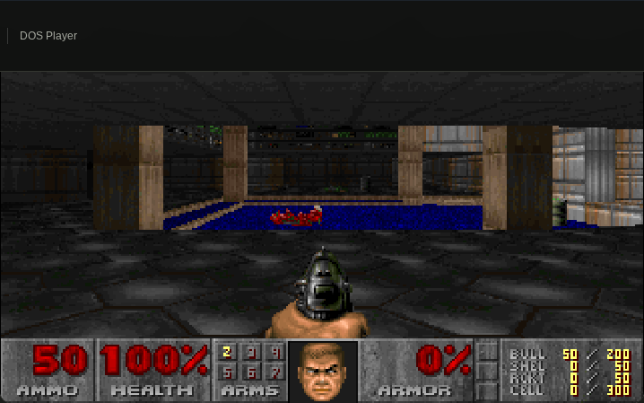
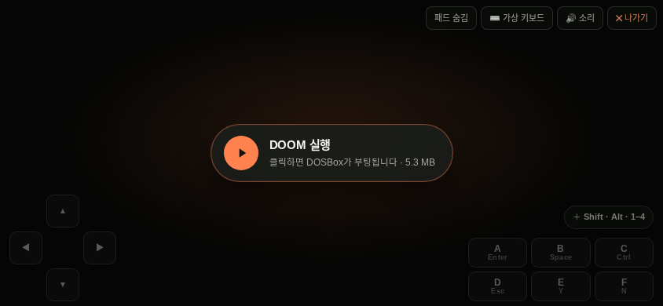

DOS Player(PKPilot0006)는 브라우저에서 고전 DOS 게임을 바로 실행하는 앱입니다. `js-dos` v8(WASM DOSBox) 위에 공개 프리웨어 번들을 얹었고, 첫 배포 때 `Digger`, DOOM 셰어웨어, Dhrystone 2 세 가지로 부팅을 확인했습니다. 부팅은 잘 됐습니다. 문제는 그다음이었습니다. **가상 패드를 눌러도 게임이 움직이지 않았습니다.**

## 증상

- 화면은 정상적으로 뜨고, 마우스 클릭으로 메뉴는 열립니다.
- 모바일 가상 패드의 방향 버튼을 눌러도 시야가 돌지 않습니다.
- 데스크톱에서 물리 키보드로 WASD를 눌러도 마찬가지입니다.

즉 입력만 죽어 있었습니다. 이럴 때 가장 흔한 원인은 포커스입니다. 에뮬레이터 캔버스가 포커스를 잃으면 키 이벤트가 document로 가고, 게임은 아무것도 받지 못합니다.

## 1단계: 합성 이벤트는 통하지 않는다

첫 시도는 포커스를 우회하는 것이었습니다. 캔버스 대신 `window`에 `KeyboardEvent`를 직접 만들어 던지면 어디에 포커스가 있든 전달될 것이라고 생각했습니다.

```js
// 이렇게 하면 될 줄 알았습니다
window.dispatchEvent(new KeyboardEvent('keydown', { key: 'ArrowUp', bubbles: true }));
```

결과는 무반응이었습니다. 원인은 js-dos v8의 구조에 있었습니다. v8은 키보드 입력을 DOM 이벤트가 아니라 **CommandInterface(`ci`)** 로 받습니다. 에뮬레이터가 준비되면 `ci.sendKeyEvent(keyObject, down)`로 키를 밀어 넣어야 하고, 합성 이벤트는 그 경로를 타지 않습니다. v8 내부의 키 코드 테이블도 DOM의 `keyCode`와 값이 다릅니다. 예를 들어 `Escape`는 27이 아니라 256입니다.

그래서 입력 경로를 하나로 모았습니다.

```js
function sendKey(code, down) {
  const kbd = KBD[code];            // { key, keyCode, location }
  if (state.ci && state.ci.sendKeyEvent) {
    state.ci.sendKeyEvent(kbd, down);   // 에뮬레이터가 직접 받습니다
    return;
  }
  // ci가 준비되기 전에만 합성 이벤트로 폴백
  target.dispatchEvent(new KeyboardEvent(down ? 'keydown' : 'keyup', { key: kbd.key, code }));
}
```

이렇게 바꾸고 나서야 메뉴 조작과 Esc가 먹히기 시작했습니다.

## 2단계: 그래도 위·아래는 아무 일도 없었다

Esc는 되는데 DOOM에서 시야가 돌지 않았습니다. 여기서 한 번 더 파고들었습니다. 원인은 코드가 아니라 **번들 안에 들어 있던 설정 파일**이었습니다.

`doom.jsdos` 압축을 풀면 안에 `DEFAULT.CFG`가 있습니다. 그 파일의 키 배열은 이렇습니다.

| 설정 | 값 | 의미 |
| --- | --- | --- |
| `key_up` / `key_down` | `W` / `S` (스캔코드 17 / 31) | 전진·후진 |
| `key_strafeleft` / `key_straferight` | `A` / `D` | 좌우 평행 이동 |
| `key_left` / `key_right` | 좌·우 방향키 | 회전 |
| `key_fire` | `Ctrl` | 사격 |
| `key_use` | `Space` | 문 열기 |
| `key_speed` | `Shift` | 달리기 |

즉 이 DOOM은 **위·아래 방향키를 게임플레이에 쓰지 않습니다.** 1993년의 관례대로 W/S로 걷습니다. 패드가 아무리 정확하게 `↑`를 보내도 게임은 그 키를 기다리지 않으니 아무 일도 일어나지 않습니다.

해결은 게임이 듣는 키를 보내는 것이었습니다. DOOM 프로필의 패드는 위·아래에 **두 키를 함께** 보냅니다.

- 게임플레이: `W` / `S`
- 메뉴: `↑` / `↓` (Esc 메뉴는 방향키로 움직입니다)

이후 사용자가 직접 키를 바꿀 수 있도록 `키 설정` 모달도 붙였습니다. 10개 동작을 다시 매핑하고, 결과는 `localStorage`에 남습니다. `Digger`처럼 방향키를 그대로 쓰는 번들은 기본 프로필을 씁니다.



## 3단계: 가로 화면에서 손가락 두 개

입력이 살아나자 다음 문제가 보였습니다. 세로 화면에서는 지도와 패드가 게임 화면을 절반이나 가립니다. 그래서 가로에서는 에뮬레이터를 화면 전체로 띄우는 오버레이를 만들었습니다.



- 왼쪽 아래에 D-pad, 오른쪽 아래에 액션 패드(`A/B/C/D/E/F`)를 두고, 버튼마다 실제 키를 표시했습니다.
- 오른쪽 위에 미니 컨트롤 바(패드 숨김 · 가상 키보드 · 소리 · 나가기)를 두어 게임 화면을 가리지 않게 했습니다.
- PC(`hover` + `fine pointer`)에서는 가상 패드를 기본으로 숨기고, `⋮` 메뉴에서 강제로 켤 수 있게 했습니다. 큰 화면에서 화면 절반을 패드가 차지하면 안 됩니다.
- 가상 키보드는 숨김 `<input>`에 포커스를 주고 안드로이드 IME의 조합 입력(229)을 처리합니다. 한글 자판이 켜져 있어도 영문 키가 그대로 들어가게 하려는 것입니다.
- iOS 사파리는 화면 고정(orientation lock)이 정책상 막혀 있어 이 기능에서 제외했습니다.

## 배운 것

- 에뮬레이터 입력은 "이벤트"가 아니라 **"명령"** 입니다. 라이브러리가 준 인터페이스를 먼저 찾아야 합니다.
- 번들 안의 설정 파일이 UI보다 우선합니다. `.jsdos`나 `.zip`을 받았다면 압축을 풀어 내부 설정까지 확인해야 합니다.
- "안 된다"는 신고를 세 단계로 쪼개면 원인이 매번 달랐습니다. 포커스, 키 코드, 게임 설정. 한 번에 고치려 했다면 세 번 헤맸을 것입니다.
