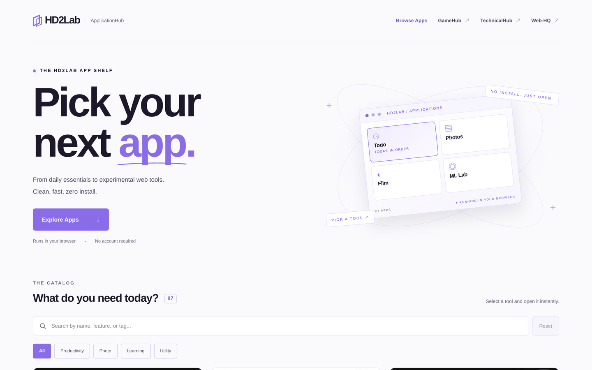
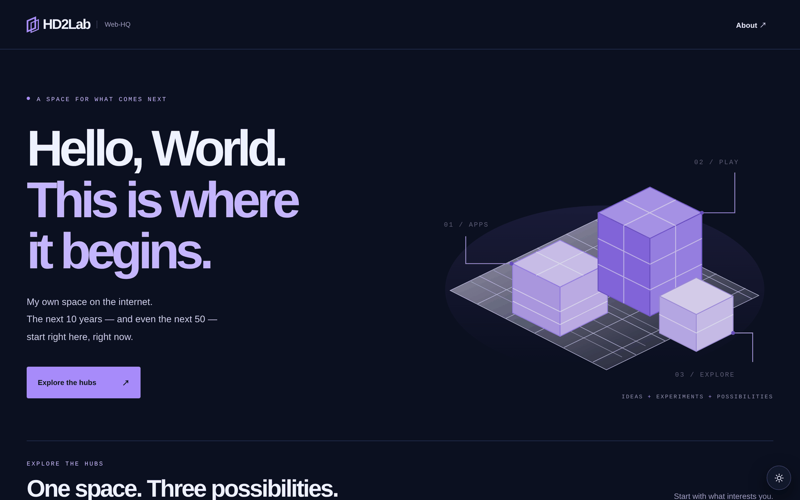

Web-HQ와 세 개의 허브, 그리고 여러 개의 PKPilot 앱은 각자 자기 색을 갖고 있었습니다. 처음에는 그게 자연스러웠습니다. 앱마다 성격이 다르고, 하나씩 만들 때는 그 편이 빠르니까요. 문제는 그다음이었습니다. 같은 서비스인데 어떤 화면은 어두운 회색 바탕에 주황 액센트를 쓰고, 어떤 화면은 흰 바탕에 보라를 썼습니다. 새 앱을 만들 때마다 색을 다시 고민해야 했고, 다크 모드를 하나 붙이려면 여섯 개 화면을 각각 손봐야 했습니다.

이번에 정리한 것은 색이 아니라 **색이 흘러가는 경로**입니다. 한 벌의 토큰, 한 벌의 토글, 그리고 앱마다 다른 자리만 남겼습니다.

## 하나의 토큰, 두 개의 팔레트

라이트 팔레트의 이름은 **Soft Iris**입니다. 흰 바탕에 아주 옅은 보라를 깔고, 액센트로 한 점만 보라를 씁니다. 다크 팔레트는 **Navy & Lavender**입니다. 같은 구성이지만 바탕이 남색으로 내려가고 액센트가 라벤더로 올라옵니다.

색은 컴포넌트에 박지 않고 CSS 변수에 담았습니다. 그래서 테마 전환은 `<html data-theme="dark">` 한 줄로 끝납니다.

| 토큰 | Soft Iris (라이트) | Navy & Lavender (다크) |
| --- | --- | --- |
| `--bg` | `#FAFAFD` | `#0B1020` |
| `--surface` | `#FFFFFF` | `#12192E` |
| `--panel-soft` | `#F4F1FC` | `#1A2340` |
| `--border` | `#E8E4F2` | `#253154` |
| `--text` | `#1D192B` | `#EEF2FF` |
| `--muted` | `#68627A` | `#94A3C4` |
| `--accent` | `#8B6CE8` | `#A78BFA` |
| `--accent-soft` | `#F1ECFE` | `rgba(167, 139, 250, .14)` |

여기서 조용하지만 중요한 결정이 하나 있습니다. 액센트가 다크에서 한 단계 밝아집니다(`#8B6CE8` → `#A78BFA`). 같은 보라를 어두운 바탕에 그대로 얹으면 대비가 부족해져서 버튼이 배경에 잠깁니다. 색을 두 벌로 나눈 이유는 예쁘게 보이기 위해서가 아니라 **같은 역할이 같은 세기로 보이게** 하기 위해서였습니다.

## 토글은 한 벌, 자리는 앱마다

토글은 모든 라우트가 같은 파일을 씁니다. `assets/hd2-theme.css`와 `assets/hd2-theme.js` 두 개이고, 하위 앱들은 사이트 루트의 `/assets/`에서 그대로 받아 갑니다. 앱마다 복사해 넣으면 반드시 한 곳이 낡습니다.

동작 방식은 이렇습니다.

- 저장 키는 `localStorage['hd2-theme']` 하나입니다. 값은 `light` 또는 `dark`, 기본은 `light`입니다.
- 각 페이지는 `<head>`에서 인라인 스니펫 한 줄로 저장값을 첫 페인트 전에 적용합니다. 그래서 다크 모드에서 새로고침해도 흰 화면이 번쩍이지 않습니다.
- `storage` 이벤트로 탭끼리 동기화하고, `<meta name="theme-color">`도 테마에 맞춰 갱신합니다.
- 버튼에는 `aria-pressed`와 `aria-label`이 테마에 따라 바뀌고, 한국어 페이지면 한국어 라벨을 씁니다. `prefers-reduced-motion`이면 전환 애니메이션을 끕니다.
- 앱 스크립트가 직접 다뤄야 할 때를 위해 `window.HD2Theme.get() / set() / toggle()`과 `hd2-theme-change` 이벤트를 열어 두었습니다.

앱마다 다른 것은 자리뿐입니다. 버튼의 위치·z-index·표면색은 `.hd2-theme-toggle`에 붙는 CSS 변수로 조정합니다.

| 라우트 | 토글 자리 | 숨기는 경우 |
| --- | --- | --- |
| Web-HQ · 3대 허브 | 우하단 기본값 | 없음 |
| PKPilot0002 Midpoint | 지도 확대/축소 스택 위 | 시트를 끝까지 올렸을 때 |
| PKPilot0003 Shutterplate | 스테이지 우하단(데스크톱은 인스펙터 왼쪽) | 모달·시트가 열렸을 때 |
| PKPilot0006 DOS Player | 셸 우하단 | 가로 풀스크린 플레이 중 |

## 아이콘은 "가려는 곳"을 가리킨다

토글은 44px 원형입니다. 44px는 손가락으로 가장 편하게 누를 수 있는 최소 크기이고, `env(safe-area-inset-*)`를 더해 아이폰 홈 인디케이터와 겹치지 않게 했습니다.

아이콘은 24×24 viewBox의 SVG를 19px로 그려 넣은 해와 달입니다. 두 아이콘을 모두 DOM에 두고, 지금 테마의 반대쪽만 CSS로 보여 줍니다. 라이트에서는 **달**, 다크에서는 **해**입니다. 지금 상태가 아니라 누르면 갈 곳을 보여 주는 편이, 버튼 하나로 두 상태를 오갈 때 덜 헷갈립니다.

## 검증은 화면마다, 두 번씩

테마는 "돌아가는 것처럼 보이는" 것과 "돌아가는 것"의 차이가 큰 작업입니다. 그래서 헤드리스 Chromium으로 일곱 개 라우트를 1440×900과 390×844 두 크기에서, 라이트와 다크 두 번씩 열어 확인했습니다.

- 콘솔 오류 0, 페이지 오류 0, 가로 넘침 0
- 토글 크기 44×44, 다른 컨트롤과 겹침 없음
- 토글 클릭 → `data-theme=dark` + 저장, 새로고침과 라우트 이동에서도 유지
- 라이트 모드 기준선과 픽셀 비교 → 차이는 토글 코너에만 국한

앱 테스트도 함께 돌렸습니다. Shutterplate 1461건, Midpoint 146건, Photos 39건 모두 통과했습니다. 공용 자산을 사이트 루트에서 서빙하도록 테스트 경로를 고친 것이 이번 작업의 숨은 절반이었습니다.

## 남은 것

- 다크에서 지도 타일과 사진 캔버스는 리테마하지 않았습니다. 콘텐츠는 콘텐츠대로 두고, 그 위의 핀·컨트롤만 다시 칠했습니다.
- 앱별 하드코딩 색을 토큰으로 바꾸는 작업은 계속 진행 중입니다. 새 컴포넌트를 넣을 때 색을 직접 쓰지 않는 습관이 남아야 이 구조가 유지됩니다.

색을 한 벌로 맞추고 나니 새 화면을 만드는 일이 가벼워졌습니다. 팔레트를 고민하는 대신 토큰을 고르면 되니까요. 디자인 시스템의 값은 결국 여기, **다음 화면을 만드는 시간**에 있습니다.
