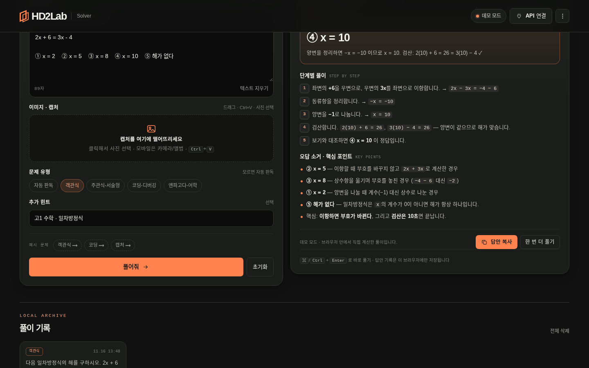
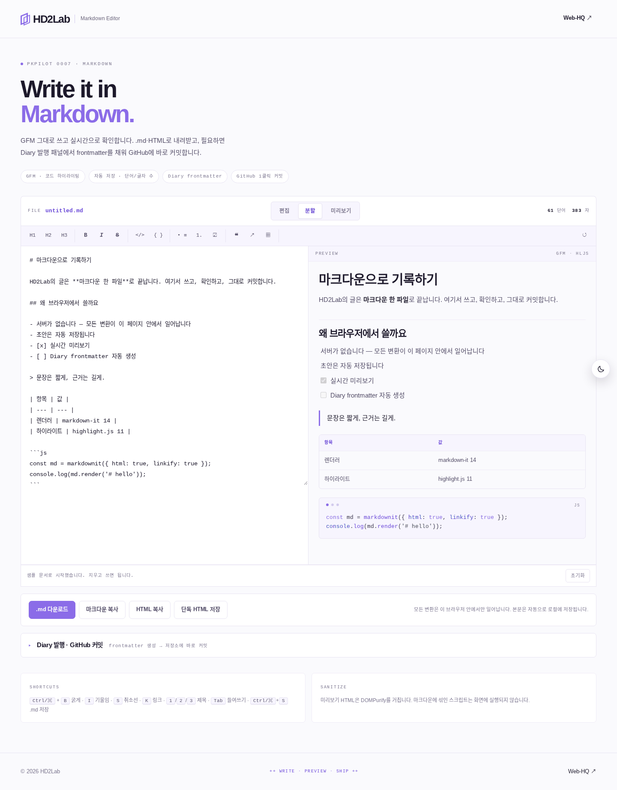
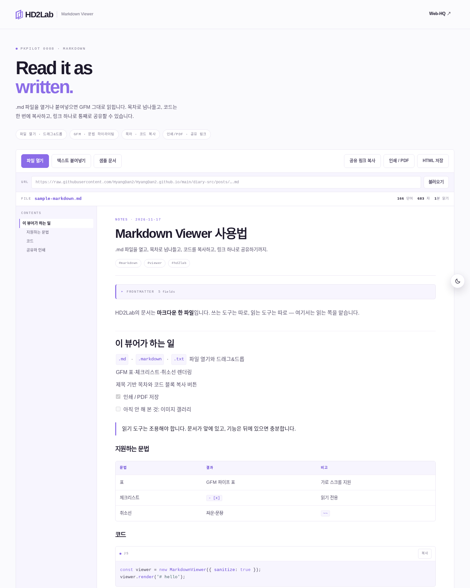

이번 글은 새로 만든 앱 두 묶음에 대한 기록입니다. 하나는 문제를 읽고 풀이를 만들어 주는 **PKPilot0005 Solver**, 다른 하나는 다이어리에서 글쓰기를 떼어내 만든 **PKPilot0007 Markdown Editor**와 **PKPilot0008 Markdown Viewer**입니다. 두 작업의 공통점은 "이 앱이 정말 해야 하는 일"을 좁힌 것입니다.

## PKPilot0005 · Solver

Solver는 문제를 넣으면 판독해서 풀이를 만들어 주는 앱입니다. 입력은 세 가지를 받습니다. 텍스트로 붙여넣기, 캡처 이미지 드래그, 클립보드 붙여넣기입니다. 문제 유형은 자동 판독을 기본으로 하고, 객관식·주관식(서술형)·코딩/디버깅·어학 문제는 직접 고를 수도 있습니다. 추가 힌트 칸에는 "고1 수학 · 일차방정식"처럼 범위를 적어 두면 판독이 훨씬 정확해집니다.

결과 화면은 정답만 보여 주지 않습니다.

- **정답 카드** — 고른 답과 검산 한 줄
- **단계별 풀이** — 이항, 정리, 계수 계산, 검산, 보기의 각 단계
- **오답 소거** — 틀린 보기가 왜 틀렸는지
- **핵심 포인트** — 이 유형에서 자주 무너지는 지점
- **답안 복사 / 한 번 더 풀기**



지금은 **데모 모드**가 기본입니다. 브라우저 안에서 직접 계산해 풀이를 만들고, 실제 모델을 붙이려면 `[API 연결]`에서 게이트웨이 주소를 넣어야 합니다. 실모델 경로는 개인 서버의 `/api/solver/solve`를 거치도록 설계해 두었고, 아직 연결하지 않았습니다. 프런트를 먼저 완성하고 백엔드를 뒤에 붙이는 순서입니다. 풀이 기록은 브라우저 로컬에만 남습니다.

## 왜 다이어리에서 글쓰기를 떼어냈나

원래 `/diary/`에는 정적 에디터가 함께 있었습니다. 쓰고, 미리 보고, GitHub 커밋 URL로 넘기는 구조였습니다. 서버 없이 글을 쓰는 가장 싼 방법이었고 지금도 그 판단은 유효합니다. 다만 공개된 읽기 화면과 쓰기 화면이 같은 사이트에 있는 것이 점점 어색해졌습니다.

- 읽는 사람에게 쓰기 버튼은 필요 없습니다.
- 쓰기 화면에는 토큰을 다루는 흐름이 있어서, 읽기 페이지와 같은 곳에 두면 실수할 여지가 늘어납니다.
- 에디터가 커지면서 다이어리 빌드와 무관한 코드가 다이어리 저장소를 계속 건드립니다.

그래서 방향을 바꿨습니다. **`/diary/`는 읽는 곳으로만 남깁니다.** 헤더·버튼·글 하단의 쓰기 링크를 모두 제거하고 `/diary/write/`는 닫았습니다. 대신 쓰기 도구를 앱으로 분리했습니다.

## PKPilot0007 · Markdown Editor

에디터는 GFM을 그대로 다룹니다. 화면은 편집·분할·미리보기 세 탭이고, 분할에서는 좌우가 같은 문서를 동시에 보여 줍니다. 툴바에는 제목(H1~H3), 굵게·기울임·취소선, 코드, 인용, 목록, 링크, 이미지, 표가 있고, 하단에는 단축키 안내가 붙습니다. 미리보기는 DOMPurify로 한 번 걸러내므로 문서에 섞인 스크립트가 화면에서 실행되지 않습니다.



이번에 붙인 것은 **불러와서 고치는** 흐름입니다. 새 글만 쓸 수 있는 에디터는 반쪽짜리였습니다.

- **로컬 파일 열기** — `.md`·`.markdown`·`.txt`를 고르거나 화면 어디에나 끌어다 놓습니다. UTF-8을 먼저 시도하고 실패하면 EUC-KR로 읽습니다.
- **frontmatter 분리** — 파일 앞의 YAML을 파싱해 제목·카테고리·날짜·슬러그·태그·요약을 폼에 채우고, 본문만 편집기에 넣습니다. 카테고리는 파일에 적힌 표기를 그대로 살립니다(`Architecture`를 소문자로 바꾸지 않습니다).
- **저장소 글 불러오기** — `diary-src/posts` 목록을 GitHub API로 받아 최신순으로 보여 주고, 고르면 바로 엽니다. 파일 바에는 `수정 중` 배지와 `[새 글로 전환]` 버튼이 뜹니다.
- **덮어쓰기 커밋** — 원본의 `sha`를 먼저 읽어 PUT에 함께 보냅니다. 성공하면 응답의 새 `sha`로 상태를 갱신하므로 다음 수정도 같은 파일을 갱신합니다. 원본이 사라졌으면(404) 덮어쓰지 않고 안내만 합니다.

PAT는 한 번 넣어 두면 `[커밋]` 한 번으로 끝납니다. 토큰은 브라우저의 `localStorage`에만 남고 서버로 가지 않습니다. 내보내기는 `.md` 다운로드, 마크다운 복사, HTML 복사, 단독 HTML 저장 네 가지입니다.

## PKPilot0008 · Markdown Viewer

뷰어는 반대편 도구입니다. `.md` 파일을 열거나, 텍스트를 붙여넣거나, URL에서 불러오면 GFM 그대로 읽힙니다. 목차가 왼쪽에 붙고, 코드 블록마다 복사 버튼이 있으며, 인쇄와 PDF 저장을 지원합니다.



공유 링크는 서버 없이 만들었습니다. 문서 전체를 압축해 URL 해시에 담습니다.

```text
https://hyangdan2.github.io/PKPilot0008/#md=<압축된 문서>
```

문서를 LZString으로 압축해 URI에 안전한 문자열로 바꾸는 방식입니다. 링크 하나로 문서가 통째로 전달되지만, 문서가 길면 URL 길이 한계에 걸립니다. 큰 문서는 파일로 주고받는 편이 낫습니다.

URL로 불러올 때는 CORS를 확인해야 합니다. 다른 사이트의 파일은 그 사이트가 허용할 때만 열립니다. GitHub의 `raw.githubusercontent.com`은 CORS를 열어 주지 않아서, 저장소의 글을 가져올 때는 API 경로를 씁니다.

## 정리

읽기와 쓰기를 한 페이지에 두면 둘 다 어색해집니다. 읽는 쪽은 가볍게, 쓰는 쪽은 도구로. Solver도 같은 원칙이었습니다. 판독·풀이·기록을 한 화면에 두되, 모델은 뒤에 붙일 수 있게 경계를 그어 두었습니다. 기능을 더하는 일보다 경계를 긋는 일이 오래 갑니다.
