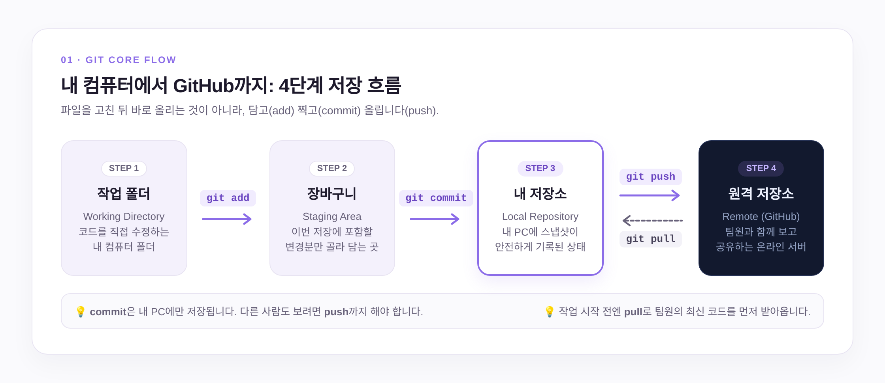
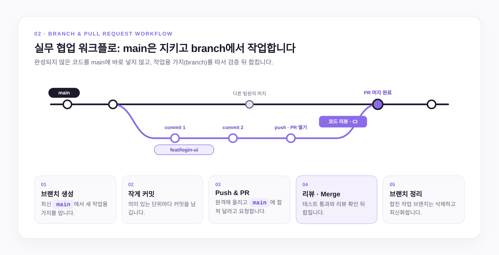
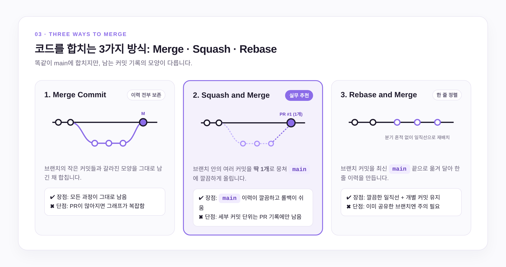

코드를 배우기 시작하면 가장 먼저 만나는 벽이 Git입니다. 명령어는 몇 개 되지 않는데, 처음 나오는 말이 전부 낯섭니다. 저장소, 스테이징, 커밋, 브랜치, 머지, 리베이스. 영어 단어를 한국어로 옮겨 놓아도 뜻이 잘 잡히지 않습니다.

이 글은 그 벽을 한 번에 넘으려는 사람을 위한 정리 노트입니다. 명령어를 전부 외우는 대신 **왜 이 순서로 일하는지**를 먼저 잡고, 실제로 손에 붙여야 하는 것만 남겼습니다. 다 읽고 나면 혼자서 저장하고, 브랜치를 따서 작업하고, 풀 리퀘스트로 합치는 한 바퀴를 돌 수 있습니다.

## 왜 Git을 쓸까요?

Git이 없던 시절의 파일 관리는 대개 이렇게 흘러갑니다.

```
보고서.docx
보고서_최종.docx
보고서_최종(수정).docx
보고서_최종_진짜최종_v3.docx
```

이름은 점점 길어지는데, 어느 것이 진짜 최신인지는 아무도 확신하지 못합니다. 열어 봐야 알고, 열어 봐도 무엇이 달라졌는지 모릅니다. 누군가 `v3`를 지우면 그 안에만 있던 문장도 함께 사라집니다.

Git은 이 지옥에서 빠져나오는 도구입니다. 파일을 통째로 복사해 쌓아 두는 대신, **무엇이 왜 바뀌었는지**를 한 줄씩 기록합니다. 그래서 세 가지가 가능해집니다.

- **원하는 시점으로 되돌아갑니다.** 커밋 하나하나가 그때의 프로젝트 전체를 찍은 사진입니다. 오늘 아침까지는 멀쩡했는데 지금은 안 돌아간다면, 아침의 사진으로 돌아가 원인을 찾습니다. 파일 이름을 바꿔 가며 복사본을 만들 필요가 없습니다.
- **여러 사람이 한 프로젝트를 함께 고칩니다.** 각자 자기 가지에서 작업하고, 검토한 뒤에 합칩니다. 누가 언제 어느 줄을 바꿨는지 남기 때문에 "이 코드 왜 이렇게 했어요?"라는 질문에 기록이 답합니다.
- **실험을 두렵지 않게 합니다.** 새 방식을 시도했다가 버리면 그 가지만 지우면 됩니다. `main`은 건드리지 않았으므로 되돌릴 것도 없습니다.

여기서 한 가지를 구분해 두면 나머지가 쉬워집니다. **Git은 내 컴퓨터에서 도는 프로그램**이고, **GitHub는 그 기록을 올려 두는 서비스**입니다. Git만으로도 혼자 쓰는 데는 부족함이 없습니다. GitHub는 그 기록을 팀과 나누고, 리뷰하고, 배포하기 위해 얹는 층입니다.

## 핵심 명령어 4대장: `add` · `commit` · `push` · `pull`

Git이 어려운 이유는 명령어가 많아서가 아니라, **파일이 지나가는 방**이 네 개라서입니다. 방이 어디인지 알면 명령어는 자연스럽게 따라옵니다.



- **작업 폴더(Working Directory)** — 내가 실제로 파일을 고치는 폴더입니다. 에디터로 열어 놓은 그 공간입니다.
- **장바구니, 스테이징(Staging Area)** — 이번 커밋에 담을 변경만 골라 놓는 곳입니다. `git add`가 여기로 넣습니다.
- **내 저장소(Local Repository)** — 커밋이 쌓이는 내 PC 안의 기록입니다. `git commit`이 여기에 사진을 남깁니다.
- **원격 저장소(Remote)** — GitHub에 있는 같은 기록입니다. `git push`로 올리고, `git pull`로 내려받습니다.

처음엔 "장바구니가 왜 필요하지?" 싶습니다. 전부 한 번에 저장하면 될 것 같습니다. 그런데 `add`가 있는 덕분에 **한 커밋에는 한 가지 변경만** 담을 수 있습니다. 로그인 기능을 고치다가 오타를 발견했을 때, 오타 수정은 따로 담아 두면 나중에 로그인만 되돌리고 오타 수정은 남길 수 있습니다. 귀찮은 단계가 아니라 되돌리기를 가능하게 하는 장치입니다.

### 한 번에 따라 하는 터미널 예시

처음 한 번만 하는 설정입니다. 이름과 메일은 커밋마다 함께 기록되고, GitHub의 잔디와 프로필이 이 주소를 기준으로 채워집니다.

```bash
git config --global user.name "홍길동"
git config --global user.email "gildong@example.com"
git config --global init.defaultBranch main
```

프로젝트 폴더를 저장소로 만들고, 첫 파일을 커밋합니다.

```bash
mkdir my-project && cd my-project
git init

echo "# My Project" > README.md
git status                       # 무엇이 바뀌었는지 확인
git add README.md                # 장바구니에 담기 (전체는 git add .)
git commit -m "docs: README에 프로젝트 소개 추가"
```

GitHub에 빈 저장소를 만들어 두고 올립니다. `-u`는 이 브랜치의 기본 원격을 기억해 두라는 뜻이라, 다음부터는 `git push`만 하면 됩니다.

```bash
git remote add origin https://github.com/<사용자이름>/my-project.git
git push -u origin main
```

다음 날 작업을 시작할 때, 그리고 다른 사람이 올린 변경을 받을 때는 이것부터입니다.

```bash
git pull
```

| 명령어 | 하는 일 |
| --- | --- |
| `git status` | 바뀐 파일과 장바구니 상태를 보여 줍니다. 무엇이든 헷갈릴 때 가장 먼저 칩니다. |
| `git add <파일>` | 고른 변경을 장바구니에 담습니다. 커밋 직전에 씁니다. 전체를 담을 때는 `git add .`입니다. |
| `git commit -m "메시지"` | 장바구니를 하나의 기록으로 남깁니다. 한 가지 작업이 끝났을 때 씁니다. |
| `git push` | 내 커밋을 원격에 올립니다. 공유하거나 백업할 때 씁니다. |
| `git pull` | 원격의 최신 기록을 받아 옵니다. 작업 시작 전, 하루에 여러 번 씁니다. |
| `git log --oneline --graph` | 커밋 이력을 한 줄씩, 갈래까지 그려서 보여 줍니다. 흐름이 궁금할 때 씁니다. |
| `git restore <파일>` | 아직 커밋하지 않은 수정을 버립니다. 실수로 고친 것을 되돌릴 때 씁니다. |

## 협업 워크플로: `main`은 지키고 `branch`에서 작업합니다

혼자 쓸 때는 `main`에 바로 커밋해도 됩니다. 여럿이 쓰기 시작하면 규칙이 하나 필요합니다. **`main`은 언제나 동작하는 상태로 둡니다.** 배포가 `main`에서 나가고, 다른 사람의 작업도 `main`에서 출발하기 때문입니다. 반쯤 만든 코드가 `main`에 들어가면 모두가 그 위에서 작업하게 됩니다.

그래서 작업마다 가지를 땁니다. 이것이 브랜치입니다.



1. **브랜치를 만듭니다.** 최신 `main`에서 출발해야 나중에 합칠 때 충돌이 적습니다.
2. **작은 단위로 커밋합니다.** 커밋 하나가 리뷰에서 설명할 수 있는 크기면 충분합니다.
3. **올리고 PR을 엽니다.** 원격에 브랜치를 push하고, GitHub에서 `main`에 합쳐 달라고 요청합니다.
4. **리뷰와 CI를 거쳐 머지합니다.** 테스트가 통과하고 동료가 승인하면 합칩니다.
5. **브랜치를 지웁니다.** 합쳐진 가지는 남겨 둘 이유가 없습니다. 남기면 목록만 지저분해집니다.

말로 하면 다섯 줄이지만, 실제로는 이렇게 칩니다.

```bash
# 1. 최신 main에서 작업 가지를 땁니다
git switch main
git pull
git switch -c feat/login-ui

# 2. 작게 커밋합니다
git add src/login.js
git commit -m "feat: 로그인 폼에 이메일 형식 검증 추가"

# 3. 원격에 올리고 PR을 엽니다
git push -u origin feat/login-ui
```

`git switch -c`는 브랜치를 만들면서 바로 그곳으로 옮겨 갑니다. 예전 자료에는 `git checkout -b`로 나오는데 같은 일을 합니다. 최근 Git은 브랜치 전용 명령인 `switch`를 권합니다.

push하고 나면 GitHub 저장소 위에 `Compare & pull request` 버튼이 뜹니다. base는 `main`, compare는 방금 올린 브랜치로 두고 PR을 엽니다. 본문에는 세 가지만 적으면 리뷰가 빨라집니다.

- **무엇을** 바꿨는지 (화면이면 스크린샷 한 장)
- **왜** 바꿨는지 (관련 이슈 번호가 있으면 `Closes #12`처럼 적습니다)
- **어떻게 확인**했는지 (실행한 테스트, 직접 눌러 본 경로)

리뷰에서 승인을 받고 CI 배지가 초록으로 바뀌면 머지합니다. 팀에서는 `main`에 보호 규칙을 걸어 두기도 합니다. `Require a pull request before merging`과 `Require status checks to pass`를 켜 두면, 실수로 `main`에 바로 push하거나 테스트가 깨진 코드를 합치는 일을 막을 수 있습니다. 머지 버튼 옆에서 방식을 고를 수 있는데, 그 이야기는 다음 절에서 합니다. 머지가 끝나면 화면의 `Delete branch` 버튼을 누르고, 내 PC에서도 정리합니다.

```bash
git switch main
git pull
git branch -d feat/login-ui
```

브랜치 이름은 팀 규칙을 따르되, 앞에 종류를 붙이면 목록에서 한눈에 구분됩니다. `feat/login-ui`, `fix/header-overflow`, `docs/git-notes` 같은 식입니다. 한 브랜치는 하루이틀 안에 머지되는 크기가 좋습니다. 일주일씩 살아 있는 브랜치는 그 사이 `main`과 멀어져 마지막에 큰 충돌로 돌아옵니다.

## 코드를 합치는 3가지 Merge 방식

PR을 머지할 때 GitHub는 세 가지 방식을 제안합니다. 결과는 같습니다. `main`에 코드가 들어갑니다. 다른 것은 **어떤 이력이 남는가**입니다.



| 방식 | 장점 | 주의할 점 |
| --- | --- | --- |
| **Merge Commit** | 작업 흐름이 전부 남고, 브랜치 단위로 되돌리기 쉽습니다 | PR이 쌓이면 그래프가 복잡해집니다 |
| **Squash and Merge** | `main` 이력이 깔끔하고, 되돌리기가 한 번입니다 | 세부 커밋 단위는 PR 기록에만 남습니다 |
| **Rebase and Merge** | 이력이 한 줄로 읽히고 개별 커밋이 살아 있습니다 | 이미 공유한 브랜치를 리베이스하면 위험합니다 |

**Squash and Merge**는 브랜치에서 "오타 수정", "테스트 깨짐 수정", "리뷰 반영"으로 쌓인 커밋을 하나로 묶습니다. `main`에는 `feat: 로그인 폼에 이메일 형식 검증 추가 (#23)` 같은 커밋 하나만 남습니다. 나중에 문제가 생기면 그 커밋 하나를 되돌리면 되고, `git log`도 읽기 편합니다. 세부 과정은 PR 안에 그대로 남으므로 잃는 것도 없습니다. 처음 시작했다면 이 방식을 기본으로 두는 편이 좋습니다. 커밋 메시지를 매번 완벽하게 쓰지 못해도 `main`이 지저분해지지 않습니다.

**Merge Commit**은 기능 브랜치를 오래 유지하거나, 릴리스 단위로 묶어서 합칠 때 어울립니다. 브랜치 전체를 하나의 덩어리로 다루고 싶을 때 씁니다.

**Rebase and Merge**는 커밋 하나하나가 의미를 갖도록 정리해 둔 사람에게 맞습니다. 다만 주의할 점이 있습니다. 리베이스는 커밋을 다른 기반 위에 **다시 얹는** 일이라 커밋 해시가 바뀝니다. 이미 push해서 동료가 받아 간 브랜치를 리베이스하면, 동료의 이력과 내 이력이 어긋나 강제 push(`git push --force-with-lease`)가 필요해집니다. 리베이스는 **아직 공유하지 않은 내 브랜치에서만** 쓰는 것이 안전합니다.

내 브랜치를 최신 `main` 위로 올려 두고 싶을 때는 이렇게 합니다. push 전에 하면 깔끔하게 정리됩니다.

```bash
git switch feat/login-ui
git fetch origin
git rebase origin/main
```

## 팀워크 시 꼭 지킬 5가지

도구를 아는 것과 함께 일이 되는 것은 다른 문제입니다. 아래 다섯 가지는 규칙이라기보다 사고를 줄이는 습관입니다.

**① 작게, 자주 커밋합니다.** 커밋 하나에는 한 가지 변경만 담습니다. 로그인 버튼 추가와 오타 수정과 설정 변경을 한 덩어리로 넣으면, 로그인에 문제가 생겼을 때 셋이 함께 되돌아갑니다. 하루에 한 번 크게 올리는 것보다, 작업이 끊기는 지점마다 커밋하고 하루 두세 번 push하는 편이 안전합니다.

**② 한눈에 읽히는 커밋 메시지를 씁니다.** 첫 줄은 50자 안쪽으로, "무엇을 했는지"를 씁니다. `수정`이나 `업데이트`는 아무것도 알려 주지 않습니다. 종류를 앞에 붙이는 관례(Conventional Commits)를 쓰면 이력이 한결 읽힙니다.

| 접두어 | 쓰는 곳 | 예시 |
| --- | --- | --- |
| `feat:` | 새 기능 | 로그인 폼에 이메일 형식 검증 추가 |
| `fix:` | 버그 수정 | 로그인 실패 시 오류 메시지가 사라지던 문제 |
| `docs:` | 문서 | README에 실행 방법 추가 |
| `refactor:` | 동작은 그대로, 구조만 정리 | 인증 로직을 별도 모듈로 분리 |
| `test:` | 테스트 | 로그인 검증 실패 케이스 추가 |
| `chore:` | 설정·의존성·잡일 | eslint 규칙 정리 |

왜 바꿨는지가 코드만으로 설명되지 않는다면, 한 줄 띄우고 본문에 적습니다. 6개월 뒤의 나와 동료가 읽을 글이라고 생각하면 충분합니다.

**③ 작업을 시작하기 전에 `pull`을 먼저 합니다.** 하루의 첫 명령으로 `git pull`을 두는 습관입니다. 어제 동료가 올린 변경 위에서 시작해야 나중에 합칠 때 부딪히지 않습니다. `git pull`은 최신 기록을 받아 오는 일(`fetch`)과 내 브랜치에 합치는 일(`merge`)을 한 번에 합니다. 커밋이 지저분하게 엮이는 것이 싫다면 `git pull --rebase`를 씁니다.

**④ 같은 파일을 동시에 고치지 않습니다.** 충돌은 대개 같은 파일, 같은 줄을 두 사람이 건드렸을 때 납니다. 파일이나 폴더 단위로 담당을 나누고, 큰 파일 하나에 모두가 손대는 구조라면 먼저 쪼갭니다. "이번에 이 파일 만집니다"라고 한 줄 남기는 것만으로도 충돌은 크게 줄어듭니다. 브랜치를 오래 끌지 않고 자주 합치는 것도 같은 이유입니다.

**⑤ 충돌(Conflict)이 나도 당황하지 않습니다.** 충돌은 실패가 아니라, Git이 "두 변경 중 어느 쪽을 남길지 사람이 정해 주어야 한다"고 알려 주는 상태입니다. 순서대로 하면 됩니다.

```bash
git status
```

`both modified`로 표시된 파일을 열면, Git이 양쪽을 이렇게 표시해 두었습니다.

```
<<<<<<< HEAD
const timeout = 3000;
=======
const timeout = 5000;
>>>>>>> feat/login-ui
```

`HEAD` 쪽이 지금 브랜치(대개 `main`)의 내용이고, 아래쪽이 합치려는 브랜치의 내용입니다. 둘 중 하나를 고르거나, 둘 다 살려 새 코드로 정리합니다. **중요한 것은 `<<<<<<<`, `=======`, `>>>>>>>` 세 줄을 지우는 것입니다.** 남겨 두면 코드가 깨집니다.

```bash
git add src/login.js     # 해결한 파일을 장바구니에 담고
git commit               # merge라면 커밋 (메시지는 기본값 그대로 두어도 됩니다)
```

리베이스 중에 충돌이 났다면 `git commit` 대신 `git rebase --continue`를 씁니다. 어느 쪽을 남길지 판단하기 어렵다면, 아직 아무것도 확정하지 않은 상태에서 `git merge --abort`(또는 `git rebase --abort`)로 원래대로 돌아갈 수 있습니다. 해결한 뒤에는 반드시 그 부분을 실행하거나 테스트합니다. 충돌 표시를 지웠다는 것과 코드가 맞게 동작한다는 것은 다른 문제입니다.

## 마무리: 오늘 해 볼 세 줄

Git은 외우는 것이 아니라 손에 붙는 것입니다. 처음부터 모든 명령어를 알 필요는 없습니다. 오늘은 폴더 하나를 만들어 `git init`으로 시작하고, 파일을 고쳐 `git add`, `git commit`까지 해 보면 충분합니다.

다음 날 `git pull`로 시작해서, 브랜치를 하나 따고, push해서 PR을 열어 보면 한 바퀴가 완성됩니다. 그다음부터는 필요할 때 `git log`와 이 글의 표를 다시 펼치면 됩니다. 막히는 지점은 대개 네 방(작업 폴더·장바구니·내 저장소·원격) 중 어디에 내 파일이 있는지 헷갈릴 때 생깁니다. 그때는 `git status` 한 번이면 대부분의 답이 나옵니다.
