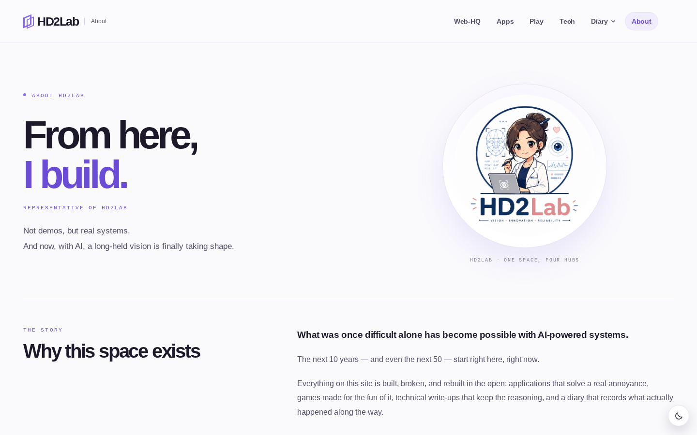
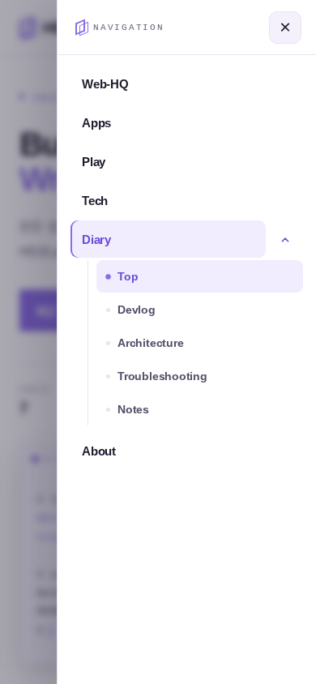
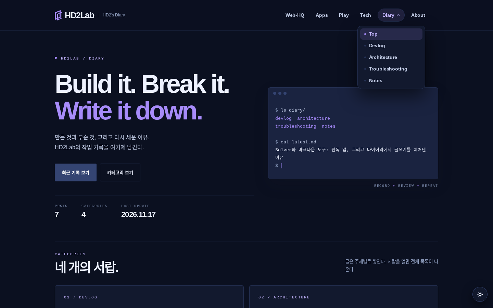

Web-HQ와 ApplicationHub·GameHub·TechnicalHub, 그리고 HD2's Diary. 다섯 곳이 같은 서비스인데도 내비게이션은 다섯 벌이었습니다. 허브 사이를 옮기려면 페이지를 아래까지 스크롤해 카드나 링크 줄을 찾아야 했고, About은 페이지가 아니라 모달이어서 주소도, 뒤로 가기도 없었습니다.

이번 작업은 화면이 아니라 **이동하는 방법**을 고친 일입니다. 페이지 위에 한 벌의 타이틀 바를 두고, 좁은 화면에서는 같은 목록을 우측 드로어로 접었습니다. 두 번의 개편으로 끝났고, 두 번째는 첫 번째를 올린 지 30분 만에 다시 만든 것입니다.

## 문제: 내비게이션이 본문 안에 있었습니다

| 사이트 | 이전 내비게이션 | 이동 비용 |
| --- | --- | --- |
| Web-HQ | 헤더에 `Diary ↗` 링크와 `About` 버튼뿐, 허브는 히어로 아래 카드 | 허브를 옮기려면 스크롤 |
| ApplicationHub | 히어로 안의 링크 줄 | 페이지마다 문구와 순서가 다름 |
| GameHub | 같음 | 같음 |
| TechnicalHub | 같음, 프로필 4페이지는 또 다른 링크 묶음 | 같음 |
| HD2's Diary | 브랜드와 `HQ ↗` 링크 하나 | Diary 밖으로 나가는 길이 하나 |

여기에 About이 모달(`#about-dialog`)이었다는 점이 겹쳤습니다. 버튼을 눌러야 열리고, 주소가 남지 않으니 공유할 수 없고, 브라우저 뒤로 가기는 페이지를 닫아 버리고, 검색에도 잡히지 않았습니다. 소개를 "대화상자"로 만든 것이 처음에는 가벼워 보였지만, 사이트의 얼굴을 보여 주는 자리로는 맞지 않았습니다.

## 방향: 페이지 위에 한 벌, 좁은 화면에는 한 겹

정한 것은 세 가지였습니다.

- **PC에서는 타이틀 바에 탭.** `Web-HQ · Apps · Play · Tech · Diary · About` 여섯 개를 같은 순서로 올리고, 지금 있는 곳을 강조합니다. 헤더는 `position: sticky`라 스크롤해도 남습니다.
- **모바일에서는 우상단 `≡` → 우측 언폴딩 사이드바.** 같은 목록을 세로로 세우고, 현재 위치는 왼쪽 강조선으로 표시합니다.
- **하위 메뉴가 있는 곳은 Diary 하나.** Diary만 카테고리가 다섯 개라, 그 행에만 한 단 더 들어갈 길(아코디언·드롭다운)을 붙였습니다.

중요한 것은 모양이 아니라 계약입니다. 여섯 라우트가 `.nav-tab`, `.nav-dropdown`, `.drawer-item`, `.drawer-group`, `.drawer-toggle`, `.drawer-sub`라는 **같은 클래스 이름**을 쓰게 했습니다. 이름이 같으면 CSS 한 벌과 스크립트 한 벌이 그대로 돌아가고, 한 곳을 고치면 나머지가 따라옵니다.

## 1차 · 탭을 올리고 About을 페이지로 (PR #69 · `7c04064`)

첫 번째 PR에서 타이틀 바와 드로어를 넣고, About을 독립 페이지로 옮겼습니다.

- Web-HQ 히어로에 있던 **`Explore the hubs` 버튼을 걷어냈습니다.** 허브로 가는 길이 타이틀 바에 생겼으니, 히어로에서 한 번 더 권할 이유가 없었습니다.
- `About`은 `/about/`이라는 정식 페이지가 됐습니다. 소개와 대표자, 이 공간이 있는 이유, 네 개 허브, 연락처와 로고를 담고, 같은 탭·드로어를 그대로 씁니다(About 활성).
- 예전 링크는 살렸습니다. `?about=1`이나 `#about`으로 들어오면 `/about/`으로 넘깁니다. 외부에 남아 있던 주소를 끊지 않으려는 세 줄입니다.

```js
if (/[?&]about=1(&|$)/.test(location.search) || location.hash === '#about') {
  location.replace('/about/');
}
```

- Diary의 `base.njk`에도 같은 탭과 드로어를 넣었습니다. 이전에는 브랜드 옆에 `HQ ↗` 하나뿐이라, Diary에서 다른 허브로 나가는 길이 사실상 없었습니다.
- 사이드바가 열려 있는 동안에는 우하단 테마 토글을 숨겼습니다. 드로어 위에 떠 있는 동그라미가 겹쳐 보이면, 누를 수 없는 버튼이 하나 더 있는 것처럼 읽힙니다.

```css
body.drawer-open { overflow: hidden; }
body.drawer-open .hd2-theme-toggle { opacity: 0; pointer-events: none; }
```

같은 규격을 세 허브에도 각각 PR로 올렸습니다(ApplicationHub #20 · GameHub #11 · TechnicalHub #17). 허브들은 `js/nav.js` 한 파일을 공유하고, TechnicalHub는 허브와 프로필 네 페이지 양쪽에 같은 마크업을 넣었습니다.

ApplicationHub에서는 이 PR에 작은 수리가 하나 더 붙었습니다. PKPilot0001·0002·0003·0006이 개별 저장소로 나가면서 카탈로그의 증빙 링크 네 개가 404가 되어 있었고, 링크 검사(`check-links`)가 그것을 잡아냈습니다. 내비게이션을 고치다가 옆의 죽은 링크를 함께 되살린 셈입니다.



## 2차 · 목록은 한 줄로, Diary는 한 단 더 (PR #70 · `016d177`)

1차를 올리고 화면을 다시 보니, 모바일 드로어가 무거웠습니다. 항목마다 `00 / HQ` 같은 메타 줄과 설명 문구가 붙은 카드형이라 두세 줄씩 차지했고, 여섯 항목이면 사이드바 절반이 설명으로 채워졌습니다. 이동 목록에서 필요한 것은 설명이 아니라 **누를 곳**입니다.

### 모바일 드로어 — 46px 한 줄 리스트

카드 상자와 메타·설명을 걷어내고, 항목을 46px 높이의 한 줄 행으로 바꿨습니다. 순서는 모든 사이트에서 `Web-HQ · Apps · Play · Tech · Diary · About`으로 고정했고, 현재 항목은 배경과 왼쪽 강조선으로 표시합니다. 46px는 손가락이 편하게 닿는 높이이면서, 여섯 항목이 스크롤 없이 한 화면에 들어오는 값입니다.

### Diary 아코디언 — 한 행에 링크와 토글을 나눠

Diary는 하위 카테고리가 다섯 개라, 행 전체를 링크로 두면 하위 메뉴로 갈 방법이 없습니다. 그래서 한 행을 둘로 나눴습니다. **왼쪽은 `/diary/`로 가는 링크, 오른쪽은 펼치는 44×44 토글**입니다.

```html
<div class="drawer-group is-open">
  <div class="drawer-row">
    <a class="drawer-item is-current" href="/diary/" aria-current="page">Diary</a>
    <button class="drawer-toggle" type="button"
            aria-expanded="true" aria-controls="drawer-diary-sub">…</button>
  </div>
  <div class="drawer-sub" id="drawer-diary-sub">
    <div class="drawer-sub-inner">
      <a class="drawer-subitem is-current" href="/diary/" aria-current="page">Top</a>
      <!-- Devlog · Architecture · Troubleshooting · Notes -->
    </div>
  </div>
</div>
```

- Diary 안에서는 **기본으로 펼쳐 둡니다.** 카테고리 사이를 옮겨 다니는 사람에게 매번 접힌 메뉴를 열게 하는 것은 한 번 더 일을 시키는 일입니다.
- 지금 보고 있는 카테고리는 하위 항목에서 강조하고, `aria-current="page"`를 붙입니다. 어느 사이트에서든 Diary 링크에는 현재 섹션을 판정해 표시합니다.
- 펼침은 `max-height` 전환으로 부드럽게 하고, `prefers-reduced-motion`이면 즉시 바뀝니다.

```css
.drawer-item   { min-height: 46px; }
.drawer-toggle { width: 44px; height: 44px; }
.drawer-sub {
  overflow: hidden;
  max-height: 0;
  opacity: 0;
  visibility: hidden;
  transition: max-height .3s cubic-bezier(.22, 1, .36, 1), opacity .2s,
              visibility 0s linear .3s;
}
.drawer-group.is-open .drawer-sub {
  max-height: 340px;
  opacity: 1;
  visibility: visible;
  transition: max-height .3s cubic-bezier(.22, 1, .36, 1), opacity .2s,
              visibility 0s linear 0s;
}
```

접힌 하위 목록을 `display: none`으로 없애지 않은 이유는 전환을 살리기 위해서입니다. 대신 접힌 동안에는 탭 순서에서 빠져야 하므로, 허브 쪽 스크립트는 하위 목록에 `inert`와 `aria-hidden`을 함께 걸고, Diary·Web-HQ는 `visibility: hidden`으로 같은 효과를 냅니다. 보이지 않는 링크에 포커스가 들어가면 키보드 사용자는 지금 어디에 있는지 알 수 없게 됩니다.



### PC — 호버와 포커스를 같은 문으로

PC에서는 Diary 탭에 마우스를 올리거나 키보드로 포커스를 주면 하위 메뉴가 내려옵니다. 스크립트 없이 CSS만으로 처리했습니다.

여기서 조용하지만 중요한 처리가 두 가지 있습니다.

- **`visibility`는 서서히 변하는 값이 아니라 단계입니다.** 펼칠 때는 즉시 보이게 하고, 닫을 때만 페이드가 끝난 뒤(0.2초) 숨깁니다. 그래야 Tab으로 들어가는 순간 링크가 이미 탭 순서에 있고, 닫히는 동안에는 포커스가 밖으로 나간 뒤에 사라집니다.
- **탭과 패널 사이에 12px 틈이 있습니다.** 마우스가 그 틈을 지나는 동안 호버가 풀려 메뉴가 닫히지 않도록, 패널 위쪽에 14px 높이의 보이지 않는 다리(`::before`)를 걸었습니다.

```css
.nav-dropdown:hover .nav-dropdown-panel,
.nav-dropdown:focus-within .nav-dropdown-panel {
  opacity: 1;
  visibility: visible;
  pointer-events: auto;
  transform: translate(-50%, 0);
  transition: opacity .18s, transform .2s, visibility 0s linear 0s;
}
```

탭 자체는 링크입니다. 하위 메뉴를 보다가 Diary 목록으로 바로 가고 싶으면 탭을 누르면 되고, 한 카테고리로 바로 가려면 드롭다운의 항목을 누르면 됩니다.



## 규격

여섯 라우트가 공유하는 값입니다. 숫자를 맞춰 두면 어느 사이트에서든 손이 같은 자리로 갑니다.

| 항목 | 값 |
| --- | --- |
| 타이틀 바 탭 높이 | 38px (알약형, `border-radius: 999px`) |
| 드로어 행 최소 높이 | 46px |
| Diary 토글 | 44 × 44px |
| 하위 항목 높이 | 40px |
| 하위 목록 들여쓰기 | 21px + 10px, 1px 세로선 |
| PC 드롭다운 패널 | 최소 폭 198px, 탭 아래 12px |
| 호버 브리지 | 14px |
| 탭 → `≡` 전환 | 허브·About 820px 이하, Diary 880px 이하 |

Diary만 전환점이 60px 높은 이유는 타이틀 바의 브랜드 잠금(`HD2Lab | HD2's Diary`)이 더 길어서입니다. 같은 값으로 맞추면 그 구간에서 브랜드와 탭이 겹칩니다.

## 통일 범위

- `Web-HQ` (루트)
- `/about/`
- `HD2's Diary` (목록·카테고리·글 페이지 전부)
- `ApplicationHub`
- `GameHub`
- `TechnicalHub` — 허브와 프로필 네 페이지 포함

## 검증

- 1440×900과 390×844 두 크기에서, 라이트와 다크 각각 열어 확인했습니다. 콘솔 오류 0, 페이지 오류 0, 가로 넘침 0.
- 드로어 행 높이가 44~48px 범위인지, 아코디언이 펼쳐지고 접히는지, 접힌 하위 링크가 탭 순서에서 빠지는지를 허브 테스트에 넣었습니다(ApplicationHub 19개, GameHub 18개 통과).
- 드롭다운은 호버·포커스로 열리고, 포커스가 빠지면 닫히는 것까지 확인했습니다.
- 링크 검사(`check-links`)를 허브마다 통과시켰습니다. 이 검사가 1차에서 죽은 PKPilot 링크 네 개를 찾아냈습니다.
- 스타일시트 캐시 키를 `v=20261118-accordion`으로 올렸습니다. 이 저장소는 빌드 산출물을 커밋하는 구조라, 키를 올리지 않으면 예전 CSS가 한동안 그대로 남습니다.

## 배운 것

- **내비게이션이 본문 안에 있으면, 이동 비용은 스크롤 길이에 비례합니다.** 같은 링크라도 페이지 위에 고정되어 있으면 "언제든 갈 수 있는 곳"이 되고, 히어로 아래에 있으면 "찾아가야 하는 곳"이 됩니다. 링크를 새로 만드는 일보다 자리를 옮기는 일이 더 큰 차이를 냅니다.
- **두 벌의 헤더는 반드시 갈라집니다.** 사이트마다 헤더를 따로 관리하는 동안 문구와 순서가 조금씩 달라졌습니다. 클래스 이름과 마크업 구조를 계약처럼 공유하면, 다음에 항목이 하나 늘어도 여섯 곳이 같은 모양으로 늘어납니다.
- **한 행에 링크와 토글을 같이 두려면 역할을 나눠야 합니다.** 라벨은 이동, 캐럿은 펼침. 캐럿은 44px로 넉넉하게, 그리고 `aria-expanded`로 상태를 말해 줍니다.
- **접힘은 사라짐이 아닙니다.** 전환을 남기려면 `display: none`을 쓸 수 없고, 그렇다면 탭 순서는 따로 정리해야 합니다. `visibility`와 `inert`는 그 둘을 동시에 만족시키는 도구입니다.
- **호버는 보너스, 포커스는 기본입니다.** 마우스를 올렸을 때만 열리는 메뉴는 키보드 사용자에게는 존재하지 않는 메뉴입니다. `:focus-within`과 `visibility` 전환을 같이 두면 같은 코드로 양쪽을 모두 받을 수 있습니다.

첫 시안을 올리고 30분 만에 다시 만든 것은 낭비가 아니었습니다. 화면에서 한 번 보고 나니 무엇이 문제인지 분명해졌고, 두 번째는 고민할 것이 거의 없었습니다. 다만 그 30분을 아끼려면, 만들기 전에 모바일 화면을 먼저 그려 봤어야 했습니다.
